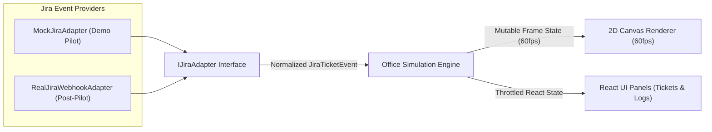
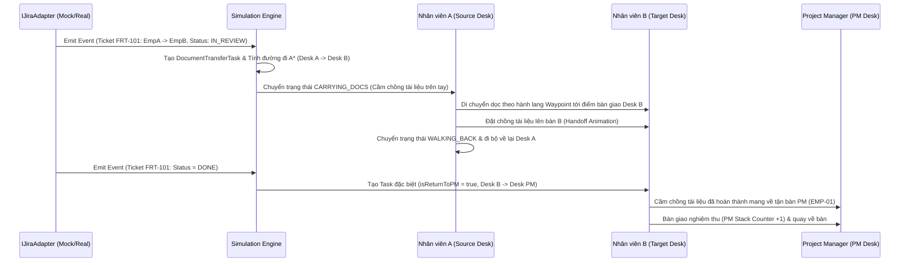

# Kiến Trúc Kỹ Thuật: Virtual FRT Office 2D - Jira Simulation Demo

## 1. Tổng Quan Dự Án (Executive Summary)

**Virtual FRT Office 2D** là ứng dụng web mô phỏng trực quan hoạt động của phòng Phát triển Phần mềm (30 nhân sự) dưới dạng văn phòng ảo 2D (Top-down Pixel/Vector Canvas).

Thay vì chỉ nhìn bảng Kanban tĩnh trên Jira, hệ thống biến mỗi sự kiện luân chuyển trạng thái Ticket (State Transition / Assignee Handoff) thành hoạt động vật lý sinh động:
- Khi Ticket chuyển từ **Nhân viên A** sang **Nhân viên B** (ví dụ: BA chuyển đặc tả cho Dev, Dev chuyển sang Tech Lead review, hoặc chuyển sang QA test), nhân vật A sẽ đứng dậy, cầm **chồng tài liệu (Document Stack)** đi dọc theo hành lang văn phòng sang tận bàn của nhân vật B để bàn giao.
- Khi Ticket hoàn tất (**Status = `DONE`**), nhân viên xử lý cuối cùng sẽ đóng gói chồng tài liệu và mang trực tiếp về **bàn của Project Manager (PM)** để nghiệm thu và lưu trữ.
- Giai đoạn hiện tại là **Demo Pilot**: sử dụng `MockJiraAdapter` để giả lập luồng công việc tự động và tương tác, đồng thời thiết kế theo **Adapter Pattern (`IJiraAdapter`)** để sẵn sàng cắm trực tiếp **Jira Webhook / Jira REST API v3** ở giai đoạn Production sau Pilot mà không phải sửa đổi tầng UI hay Simulation Engine.

---

## 2. Tech Stack & Công Nghệ Sử Dụng

| Tầng (Layer) | Công nghệ lựa chọn | Lý do lựa chọn |
| :--- | :--- | :--- |
| **Core Framework** | **Vite + React 18 + TypeScript 5** | Khởi tạo cực nhanh, hỗ trợ HMR, Strict Type-safety cho toàn bộ cấu trúc nhân sự, toạ độ lưới, và sự kiện Jira. |
| **2D Rendering Engine** | **HTML5 Canvas 2D API (Custom 60fps Renderer)** | Kiểm soát tuyệt đối vòng lặp `requestAnimationFrame`, dễ vẽ sàn gạch, 30 bàn làm việc, nhân vật hoạt hoạ cầm tài liệu, đường đi A*, bong bóng trạng thái (speech/ticket bubbles) với chi phí bộ nhớ cực thấp và không phụ thuộc nặng vào WebGL asset ngoài. |
| **UI & Control Panel** | **TailwindCSS + Lucide React Icons** | Xây dựng nhanh Sidebar điều khiển Simulation, Jira Kanban Mini-board, Activity Feed, Inspector từng nhân viên và bộ điều chỉnh tốc độ (`1x`, `2x`, `4x`). |
| **Pathfinding & Spatial** | **2D Grid A* (A-Star) + Corridor Waypoints** | Đảm bảo 30 nhân viên di chuyển mượt theo lối đi (corridors), tránh đi xuyên qua bàn ghế hay vật cản. |
| **Integration Pattern** | **Jira Provider Adapter (`IJiraAdapter`)** | Tách biệt hoàn toàn nguồn phát sinh sự kiện Ticket (`MockJiraAdapter` vs `RealJiraWebhookAdapter`) khỏi Simulation Engine. |

---

## 3. Cấu Trúc Thư Mục Dự Án (Project Directory Structure)

```text
virtual-frt/
├── docs/
│   └── ARCHITECTURE.md              # Tài liệu kiến trúc hệ thống
├── src/
│   ├── types/
│   │   └── office.ts                # Toàn bộ Interfaces: Employee, JiraTicket, Layout, Adapter, Simulation
│   ├── data/
│   │   ├── employees.ts             # Danh sách chuẩn 30 nhân viên phòng lập trình FRT
│   │   └── officeLayout.ts          # Toạ độ 30 bàn, phân khu (Zones), Waypoints & Lưới lối đi 2D
│   ├── adapters/
│   │   ├── IJiraAdapter.ts          # Re-export hoặc helper cho Jira Adapter contract
│   │   ├── MockJiraAdapter.ts       # Bộ sinh sự kiện Jira tự động & theo kịch bản cho bản Demo Pilot
│   │   └── RealJiraWebhookAdapter.ts# Khung kết nối WebSocket/SSE & REST API tới Jira thật sau Pilot
│   ├── engine/
│   │   ├── pathfinding.ts           # Thuật toán A* trên lưới 2D + làm mượt đường đi qua Waypoint
│   │   ├── simulationEngine.ts      # Vòng lặp cập nhật vị trí nhân viên, Document Transfer Queue
│   │   └── officeRenderer.ts        # Render Canvas 2D: sàn, vùng team, bàn, nhân vật, chồng tài liệu
│   ├── components/
│   │   ├── OfficeCanvas.tsx         # Component chứa Canvas 2D tương tác (hover/click bàn & nhân viên)
│   │   ├── SimulationControls.tsx   # Thanh điều khiển Play/Pause, tốc độ, nút tạo Ticket / Trigger Done
│   │   ├── TicketBoardPanel.tsx     # Bảng theo dõi trạng thái Jira Tickets thời gian thực
│   │   └── ActivityLogPanel.tsx     # Nhật ký bàn giao chồng tài liệu (A -> B, X -> PM)
│   ├── App.tsx
│   └── main.tsx
└── package.json
```

---

## 4. Kiến Trúc Jira Provider Adapter (`IJiraAdapter`)

Để đảm bảo mục tiêu **"Demo Pilot chạy mượt độc lập, sau Pilot cắm Jira thật vào ngay"**, hệ thống áp dụng mẫu thiết kế **Adapter Pattern** kết hợp **Observer/Event Stream**.



### 4.1. Hợp đồng giao tiếp `IJiraAdapter`
Mọi nguồn dữ liệu Jira đều phải thực thi interface `IJiraAdapter` (định nghĩa tại `src/types/office.ts`):
- `connect(): Promise<void>` / `disconnect(): void`: Khởi tạo hoặc đóng luồng lắng nghe sự kiện.
- `getInitialTickets(): Promise<JiraTicket[]>`: Lấy danh sách ticket hiện có khi mở văn phòng ảo.
- `createTicket(payload): Promise<JiraTicket>`: Tạo ticket mới (mặc định khởi phát từ PM hoặc BA).
- `transitionTicket(ticketId, nextStatus, nextAssigneeId, note?): Promise<JiraTicket>`: Chuyển trạng thái và người phụ trách, kích hoạt sự kiện bàn giao tài liệu.
- `onTicketEvent(listener: (event: JiraWebhookEvent) => void): () => void`: Đăng ký callback nhận sự kiện chuẩn hoá (`TICKET_CREATED`, `TICKET_ASSIGNED`, `TICKET_TRANSITIONED`, `TICKET_DONE`).

### 4.2. Hai chế độ vận hành
1. **`MockJiraAdapter` (Sử dụng trong Demo Pilot)**:
   - Chứa bộ sinh kịch bản (Scenario Generator) mô phỏng quy trình chuẩn của phòng lập trình FRT:
     `PM (Tạo Ticket)` $\rightarrow$ `BA (Phân tích)` $\rightarrow$ `Tech Lead (Thiết kế/Chia việc)` $\rightarrow$ `Dev (BE/FE/Mobile Code)` $\rightarrow$ `Tech Lead (Code Review)` $\rightarrow$ `QA (Kiểm thử)` $\rightarrow$ `DevOps (Release)` $\rightarrow$ `DONE (Mang tài liệu về bàn PM)`.
   - Cho phép người xem Demo bấm nút **"Giao Ticket mới"**, **"Chuyển bước tiếp theo"**, hoặc **"Hoàn thành Ticket (Mang về PM)"** ngay trên giao diện.
2. **`RealJiraWebhookAdapter` (Sử dụng sau giai đoạn Pilot)**:
   - Nhận sự kiện `jira:issue_updated`, `jira:issue_created` từ Backend Proxy / Webhook Relay qua WebSocket hoặc Server-Sent Events (SSE).
   - Ánh xạ `accountId` hoặc `email` trên Jira sang `employee.id` (`EMP-01` .. `EMP-30`) thông qua trường `jiraAccountId`.
   - Khi trường `status` trên Jira chuyển thành `Done` / `Closed`, Adapter tự động phát sự kiện `TICKET_DONE` với đích đến cuối cùng là bàn của PM (`EMP-01`).

---

## 5. Quy Trình Luân Chuyển Chồng Tài Liệu (Document Stack Lifecycle)

Mỗi Jira Ticket được biểu diễn trực quan bằng một **Chồng Tài Liệu (Document Stack)** có độ dày (`documentStackSize`: từ 1 đến 5 tập hồ sơ dựa trên `storyPoints` hoặc độ phức tạp của Ticket) và màu sắc theo độ ưu tiên (`priority`).



### Các quy tắc nghiệp vụ cốt lõi:
1. **Handoff giữa nhân viên A $\rightarrow$ B**:
   - Khi Ticket đổi `assigneeId` từ A sang B, nhân viên A nhấc chồng tài liệu khỏi bàn mình, đi theo lộ trình ngắn nhất trên lưới lối đi tới `handoffPoint` trước bàn nhân viên B.
   - Sau khi trao tài liệu (dừng 0.5s để hiển thị hiệu ứng bàn giao), nhân viên B bắt đầu xử lý (`WORKING`), còn nhân viên A quay trở về bàn của mình.
2. **Khi Ticket chuyển sang `DONE` (Quy tắc Về Bàn PM)**:
   - Bất kể người xử lý cuối cùng là Dev, QA hay DevOps, khi Ticket đạt trạng thái `DONE`, hệ thống tự động tạo một `DocumentTransferTask` với `isReturnToPM = true` và `toEmployeeId = 'EMP-01'` (Project Manager).
   - Nhân viên đó cầm chồng tài liệu có đóng dấu xanh **DONE** đi dọc văn phòng về bàn PM tại khu vực `ZONE-PM`, đặt lên bàn PM rồi mới quay về vị trí cũ.

---

## 6. Bố Cục Không Gian Văn Phòng 30 Nhân Sự & Cơ Chế Pathfinding

### 6.1. Hệ toạ độ & Lưới 2D (Grid System)
- **Kích thước Canvas chuẩn**: `1440 x 900` pixels.
- **Kích thước ô lưới (`TILE_SIZE`)**: `30 x 30` pixels $\Rightarrow$ Lưới văn phòng gồm **48 cột (cols) $\times$ 30 hàng (rows)**.
- **Phân bổ 30 nhân sự theo 7 cụm bàn (Zones)**:
  1. **PM & BA Command Center (`ZONE-PM`)**: 3 bàn (`EMP-01` PM, `EMP-02`..`EMP-03` BA) — đặt tại vị trí trung tâm phía Bắc/Tây Bắc để dễ quan sát và nhận tài liệu nghiệm thu.
  2. **Tech Leads Hub (`ZONE-LEAD`)**: 3 bàn (`EMP-04`..`EMP-06`) — nằm ở trục giao thông trung tâm, kết nối giữa PM/BA và các đội phát triển.
  3. **Backend Engineering (`ZONE-BE`)**: 8 bàn (`EMP-07`..`EMP-14`) — chia thành 2 dãy bàn đôi phía Tây/Trung tâm.
  4. **Frontend Engineering (`ZONE-FE`)**: 6 bàn (`EMP-15`..`EMP-20`) — cụm bàn khu vực Trung tâm/Đông.
  5. **Mobile Engineering (`ZONE-MOBILE`)**: 4 bàn (`EMP-21`..`EMP-24`) — cụm bàn phía Tây Nam.
  6. **QA & Testing Lab (`ZONE-QA`)**: 4 bàn (`EMP-25`..`EMP-28`) — cụm bàn phía Đông Nam (nơi nhận tài liệu kiểm thử trước khi Done).
  7. **DevOps & Cloud Infra (`ZONE-DEVOPS`)**: 2 bàn (`EMP-29`..`EMP-30`) — cạnh phòng Server ở góc Đông Bắc.

### 6.2. Thuật toán tìm đường A* kết hợp Waypoint (Hybrid A* Grid & Corridor Waypoints)
- Mỗi bàn làm việc (`DeskPosition`) chiếm một vùng ô lưới không thể đi xuyên qua (`walkable = false`), nhưng định nghĩa sẵn một **`handoffPoint` (ô lưới đứng giao/nhận tài liệu ngay cạnh bàn)** luôn nằm trên ô lối đi (`walkable = true`).
- Khi cần di chuyển từ `fromDesk` sang `toDesk`:
  1. Tìm đường trên lưới 48x30 từ `fromDesk.handoffPoint` tới `toDesk.handoffPoint` bằng **A* (Manhattan/Octile heuristic)** có trọng số ưu tiên đi vào trục hành lang chính (`Waypoints`) để nhân viên đi theo lối đi tự nhiên, không cắt góc sát mép bàn người khác.
  2. Nội suy vị trí thực `(x, y)` theo vận tốc `baseSpeed * config.speedMultiplier * deltaTime` ở tần số 60fps.
  3. Nếu một nhân viên đang bận đi giao tài liệu mà phát sinh thêm task mới, task mới sẽ được đẩy vào `transferQueue` để xử lý tuần tự, đảm bảo một nhân viên không bị phân thân trên màn hình.

---

## 7. Quản Lý Trạng Thái & Vòng Lặp Mô Phỏng (State Management & 60fps Loop)

Để vừa render mượt 30 nhân viên chuyển động liên tục ở **60fps**, vừa cập nhật giao diện React (Danh sách Ticket, Nhật ký bàn giao, Bộ đếm KPI) mà **không gây re-render toàn bộ cây React 60 lần/giây**, kiến trúc tách làm 2 tầng dữ liệu:

1. **High-Frequency Mutable Simulation State (60fps Canvas State)**:
   - Lưu trữ toạ độ tức thời `currentPosition {x, y}`, hướng nhìn `facing`, frame hoạt hoạ bước chân `walkFrame`, và tiến độ di chuyển `progress (0..1)` của các `DocumentTransferTask`.
   - Được cập nhật trực tiếp trong vòng lặp `requestAnimationFrame` và vẽ thẳng lên `<canvas>`.
2. **Low-Frequency Reactive UI State (Event-driven React State)**:
   - Chỉ cập nhật khi có sự kiện nghiệp vụ thực sự xảy ra:
     - Có Ticket mới được tạo hoặc đổi trạng thái (`tickets`).
     - Bắt đầu một lượt mang tài liệu hoặc vừa đặt tài liệu xuống bàn (`activeTransfers`, `activityLogs`).
     - Thay đổi cấu hình Simulation (`SimulationConfig`: tốc độ `1x/2x/4x`, tạm dừng, bật/tắt hiển thị lưới Waypoint).
3. **Cơ chế đồng bộ**:
   - Khi một `DocumentTransferTask` trên Canvas đi hết quãng đường (`progress >= 1`), Simulation Engine phát callback `onTransferCompleted(task)` để cập nhật trạng thái Ticket đích, cộng số lượng hồ sơ trên bàn người nhận (hoặc bàn PM), và ghi thêm một dòng vào `ActivityLogEntry`.
