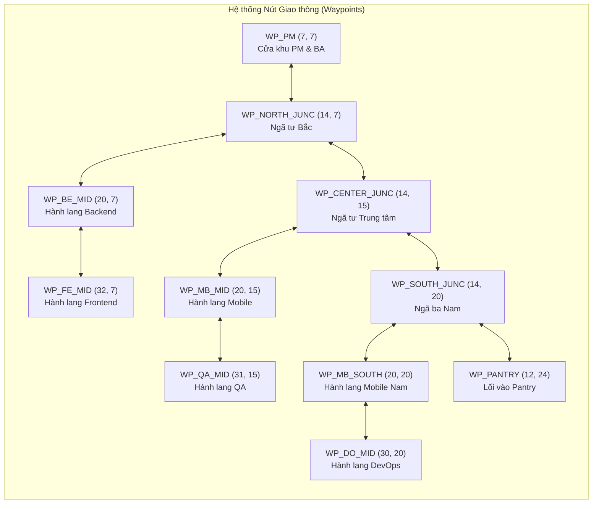
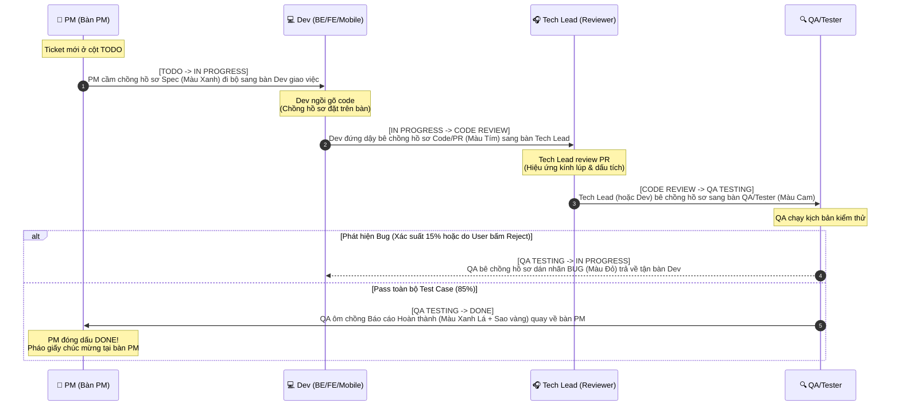

# Virtual FRT Office 2D - Jira Simulation Demo
**Tài liệu Thiết kế Sản phẩm & Game (Product & Game Design Document - GDD)**  
**Phiên bản:** 1.0 (Pilot Demo)  
**Vai trò biênsoạn:** Product & Game Designer  

---

## 1. Tổng quan Dự án (Executive Summary)

**Virtual FRT Office 2D - Jira Simulation Demo** là ứng dụng mô phỏng trực quan hóa quy trình làm việc (workflow visualization) của **Phòng Lập Trình FRT gồm đúng 30 thành viên** dưới góc nhìn 2D Top-Down Pixel/Vector (tương tự *Gather.town* kết hợp *Game Dev Tycoon*).

### Cơ chế cốt lõi (Core Loop)
Thay vì chỉ nhìn những thẻ bài tĩnh dịch chuyển trên bảng Jira truyền thống, mọi sự kiện thay đổi trạng thái hoặc người phụ trách (Assignee) của Ticket đều được chuyển hóa thành **hành vi vật lý trong văn phòng 2D**:
1. **Giao việc & Chuyển trạng thái (Handoff):** Khi Ticket được giao hoặc chuyển sang bước tiếp theo (ví dụ: PM giao việc cho Dev A, hoặc Dev A code xong chuyển sang cho QA B test), nhân vật A sẽ **đứng dậy khỏi ghế, bê một chồng tài liệu (Document Stack)** trên tay, đi bộ theo hệ thống đường dẫn (walkable paths) sang tận bàn của nhân vật B và trao tận tay chồng hồ sơ đó.
2. **Xử lý tại bàn (Desk Processing):** Khi nhận chồng tài liệu, tài liệu được đặt lên mặt bàn của nhân vật B. Nhân vật B chuyển sang trạng thái bận (Typing / Reviewing / Testing) với thanh tiến trình (progress bar) và hiệu ứng động tương ứng.
3. **Báo cáo hoàn tất (DONE Delivery):** Khi Ticket chuyển sang trạng thái **DONE**, người xử lý cuối cùng (thường là QA sau khi verify pass, hoặc DevOps sau khi deploy) sẽ **ôm chồng tài liệu báo cáo kết quả đi bộ quay về bàn của Project Manager (PM)** để nộp báo cáo nghiệm thu.

---

## 2. Danh sách 30 Thành viên Phòng Lập Trình (30-Member Roster)

Phòng lập trình có quy mô cố định **30 nhân sự**, được phân bổ vào **8 vai trò (Roles)** và tổ chức thành **6 Khu vực/Squad chuyên môn**:
- **Project Manager (PM):** 2 thành viên
- **BA / Product Designer:** 3 thành viên
- **Tech Lead:** 3 thành viên
- **Backend Developer (BE):** 7 thành viên
- **Frontend Developer (FE):** 6 thành viên
- **Mobile Developer (Mobile):** 4 thành viên
- **QA / Tester (QA):** 3 thành viên
- **DevOps / Infra (DevOps):** 2 thành viên
- **Tổng cộng:** **30 thành viên**

### 2.1. Bảng Quy ước Màu sắc & Đặc điểm Nhận diện theo Vai trò (Role Visual Identity)

| Role Code | Vai trò (Role) | Số lượng | Màu chủ đạo (Hex) | Phụ kiện / Avatar Đặc trưng | Vai trò trong luồng Handoff |
| :--- | :--- | :---: | :--- | :--- | :--- |
| `PM` | Project Manager | 2 | `#F59E0B` (Amber Gold) | Áo vest lịch sự, đeo thẻ bài vàng, bàn có cờ hiệu | Nơi phát hành Ticket mới & nhận báo cáo `DONE` cuối cùng |
| `BA` | BA / Designer | 3 | `#EC4899` (Rose Pink) | Kính gọng tròn, bảng vẽ Wacom / iPad trên bàn | Phối hợp với PM chuẩn bị tài liệu Spec, UX/UI Review |
| `TL` | Tech Lead | 3 | `#8B5CF6` (Royal Purple) | Tai nghe chụp tai lớn, áo hoodie tím, 3 màn hình | Nhận chồng tài liệu ở bước `CODE REVIEW`, duyệt PR |
| `BE` | Backend Dev | 7 | `#3B82F6` (Electric Blue) | Áo thun xanh, cốc cà phê đen, màn hình terminal xanh lá | Nhận việc xử lý logic API/DB (`IN PROGRESS`) |
| `FE` | Frontend Dev | 6 | `#06B6D4` (Cyan Teal) | Áo sơ mi kẻ/thun cyan, màn hình hiển thị giao diện web | Nhận việc xử lý UI/Web (`IN PROGRESS`) |
| `MB` | Mobile Dev | 4 | `#10B981` (Emerald Green) | Áo xanh lá, trên bàn có giá đỡ điện thoại test iOS/Android | Nhận việc xử lý App Mobile (`IN PROGRESS`) |
| `QA` | QA / Tester | 3 | `#F97316` (Vibrant Orange) | Đeo kính lúp/kính bảo hộ, biểu tượng bọ (bug) trên bàn | Nhận tài liệu ở bước `QA TESTING` & mang báo cáo `DONE` về cho PM |
| `DO` | DevOps | 2 | `#EF4444` (Crimson Red) | Mũ lưỡi trai đỏ, bàn cạnh tủ rack Server nhấp nháy đèn | Hỗ trợ CI/CD, Infra Ticket & nghiệm thu hệ thống |

### 2.2. Danh sách Chi tiết 30 Thành viên & Toạ độ Bàn làm việc (Grid 40x28)

> **Hệ quy chiếu Bản đồ (Grid Coordinate System):**  
> Mặt bằng văn phòng được chia theo lưới ô vuông **40 cột (X: `0` -> `39`) x 28 hàng (Y: `0` -> `27`)**, mỗi ô tương ứng `32x32 px` (tổng kích thước vùng vẽ chuẩn `1280x896 px`). Mỗi bàn làm việc có 1 điểm dừng giao nhận tài liệu (**Handoff Point**) nằm ngay cạnh hành lang.

| STT | Mã NV (ID) | Họ và Tên | Vai trò (Role) | Squad / Khu vực | Zone ID | Toạ độ Bàn `(X, Y)` | Điểm Handoff `(X, Y)` | Màu sắc & Avatar Đặc trưng |
| :-: | :--- | :--- | :--- | :--- | :--- | :---: | :---: | :--- |
| 01 | `FRT-01` | **Nguyễn Minh Quân** | Project Manager | Management Hub | `ZONE-PM` | `(5, 5)` | `(5, 7)` | Vest vàng `#F59E0B`, tóc vuốt gọn, bàn lớn trưởng dự án |
| 02 | `FRT-02` | **Trần Thu Hà** | Project Manager | Management Hub | `ZONE-PM` | `(9, 5)` | `(9, 7)` | Blazer vàng `#F59E0B`, tóc ngang vai, cầm sổ kế hoạch Sprint |
| 03 | `FRT-03` | **Lê Hoàng Nam** | BA / Designer | Product & BA | `ZONE-BA` | `(4, 11)` | `(4, 9)` | Áo hồng `#EC4899`, kính tròn, chuyên viết PRD & Flowchart |
| 04 | `FRT-04` | **Phạm Bảo Ngọc** | BA / Designer | Product & BA | `ZONE-BA` | `(7, 11)` | `(7, 9)` | Áo cardigan hồng `#EC4899`, tóc búi, bàn có bảng màu UI/UX |
| 05 | `FRT-05` | **Đặng Quốc Khánh** | BA / Designer | Product & BA | `ZONE-BA` | `(10, 11)` | `(10, 9)` | Áo polo hồng `#EC4899`, chuyên phân tích nghiệp vụ ERP/Retail |
| 06 | `FRT-06` | **Vũ Đức Anh** | Tech Lead | Squad Alpha (Core/BE) | `ZONE-BE` | `(16, 4)` | `(16, 6)` | Hoodie tím `#8B5CF6`, 3 màn hình cong, Lead kiến trúc Backend |
| 07 | `FRT-07` | **Hoàng Gia Bảo** | Tech Lead | Squad Beta (Web/FE) | `ZONE-FE` | `(28, 4)` | `(28, 6)` | Áo khoác tím `#8B5CF6`, tai nghe trắng, Lead kiến trúc Frontend |
| 08 | `FRT-08` | **Ngô Thanh Tùng** | Tech Lead | Squad Gamma (Mobile) | `ZONE-MB` | `(16, 17)` | `(16, 15)` | Áo thun tím `#8B5CF6`, đeo kính cận, Lead giải pháp Mobile App |
| 09 | `FRT-09` | **Bùi Quang Huy** | Backend Dev | Squad Alpha (Core/BE) | `ZONE-BE` | `(19, 4)` | `(19, 6)` | Áo xanh dương `#3B82F6`, chuyên Microservices & Golang |
| 10 | `FRT-10` | **Đỗ Tuấn Kiệt** | Backend Dev | Squad Alpha (Core/BE) | `ZONE-BE` | `(22, 4)` | `(22, 6)` | Áo xanh dương `#3B82F6`, đầu nấm, chuyên Database & Kafka |
| 11 | `FRT-11` | **Lý Thành Đạt** | Backend Dev | Squad Alpha (Core/BE) | `ZONE-BE` | `(25, 4)` | `(25, 6)` | Áo xanh dương `#3B82F6`, đeo headphone đen, chuyên Payment API |
| 12 | `FRT-12` | **Trịnh Văn Quyết** | Backend Dev | Squad Alpha (Core/BE) | `ZONE-BE` | `(16, 11)` | `(16, 9)` | Áo sơ mi xanh `#3B82F6`, chuyên tích hợp Jira/ERP Webhook |
| 13 | `FRT-13` | **Đinh Công Vinh** | Backend Dev | Squad Alpha (Core/BE) | `ZONE-BE` | `(19, 11)` | `(19, 9)` | Áo xanh dương `#3B82F6`, cốc trà đá, chuyên Order Engine |
| 14 | `FRT-14` | **Phan Mạnh Cường** | Backend Dev | Squad Alpha (Core/BE) | `ZONE-BE` | `(22, 11)` | `(22, 9)` | Áo xanh dương `#3B82F6`, tóc xoăn, chuyên Inventory Service |
| 15 | `FRT-15` | **Hồ Sỹ Phúc** | Backend Dev | Squad Alpha (Core/BE) | `ZONE-BE` | `(25, 11)` | `(25, 9)` | Áo xanh dương `#3B82F6`, kính gọng đen, chuyên Auth & Security |
| 16 | `FRT-16` | **Nguyễn Hải Đăng** | Frontend Dev | Squad Beta (Web/FE) | `ZONE-FE` | `(31, 4)` | `(31, 6)` | Áo cyan `#06B6D4`, chuyên React/Next.js & Design System |
| 17 | `FRT-17` | **Lương Minh Tuấn** | Frontend Dev | Squad Beta (Web/FE) | `ZONE-FE` | `(34, 4)` | `(34, 6)` | Áo cyan `#06B6D4`, tóc vàng highlight, chuyên Canvas/WebGL 2D |
| 18 | `FRT-18` | **Cao Thùy Linh** | Frontend Dev | Squad Beta (Web/FE) | `ZONE-FE` | `(37, 4)` | `(37, 6)` | Áo len cyan `#06B6D4`, tóc đuôi ngựa, chuyên Animation & CSS |
| 19 | `FRT-19` | **Tạ Quốc Việt** | Frontend Dev | Squad Beta (Web/FE) | `ZONE-FE` | `(28, 11)` | `(28, 9)` | Áo cyan `#06B6D4`, chuyên Dashboard & Data Visualization |
| 20 | `FRT-20` | **Mai Phương Thảo** | Frontend Dev | Squad Beta (Web/FE) | `ZONE-FE` | `(31, 11)` | `(31, 9)` | Áo sơ mi cyan `#06B6D4`, chuyên State Management & Performance |
| 21 | `FRT-21` | **Châu Nhật Minh** | Frontend Dev | Squad Beta (Web/FE) | `ZONE-FE` | `(34, 11)` | `(34, 9)` | Áo hoodie cyan `#06B6D4`, chuyên Portal nội bộ & Form Engine |
| 22 | `FRT-22` | **Lâm Chấn Khang** | Mobile Dev | Squad Gamma (Mobile) | `ZONE-MB` | `(19, 17)` | `(19, 15)` | Áo xanh ngọc `#10B981`, chuyên iOS Swift/SwiftUI |
| 23 | `FRT-23` | **Võ Hoài Nam** | Mobile Dev | Squad Gamma (Mobile) | `ZONE-MB` | `(22, 17)` | `(22, 15)` | Áo xanh ngọc `#10B981`, chuyên Android Kotlin/Compose |
| 24 | `FRT-24` | **Đoàn Khánh Đoan** | Mobile Dev | Squad Gamma (Mobile) | `ZONE-MB` | `(16, 22)` | `(16, 20)` | Áo xanh ngọc `#10B981`, tóc ngắn cá tính, chuyên Flutter |
| 25 | `FRT-25` | **Kiều Minh Tuấn** | Mobile Dev | Squad Gamma (Mobile) | `ZONE-MB` | `(19, 22)` | `(19, 20)` | Áo xanh ngọc `#10B981`, chuyên React Native & MiniApp |
| 26 | `FRT-26` | **Trương Mỹ Duyên** | QA / Tester | Quality Assurance | `ZONE-QA` | `(28, 17)` | `(28, 15)` | Áo cam `#F97316`, QA Lead, chuyên kiểm thử tích hợp & E2E |
| 27 | `FRT-27` | **Nghiêm Xuân Bách** | QA / Tester | Quality Assurance | `ZONE-QA` | `(31, 17)` | `(31, 15)` | Áo cam `#F97316`, kính lúp soi bug, chuyên Automation Test |
| 28 | `FRT-28` | **Chu Thanh Huyền** | QA / Tester | Quality Assurance | `ZONE-QA` | `(34, 17)` | `(34, 15)` | Áo cam `#F97316`, tóc tết, chuyên Mobile & API Testing |
| 29 | `FRT-29` | **Hà Việt Dũng** | DevOps | Infra & Cloud | `ZONE-DO` | `(28, 22)` | `(28, 20)` | Áo đỏ `#EF4444`, mũ lưỡi trai, chuyên Kubernetes & Cloud |
| 30 | `FRT-30` | **Tăng Duy Tân** | DevOps | Infra & Cloud | `ZONE-DO` | `(31, 22)` | `(31, 20)` | Áo đỏ `#EF4444`, tai nghe chống ồn, chuyên CI/CD & Monitoring |

---

## 3. Thiết kế Sơ đồ Mặt bằng Văn phòng 2D (Office Floorplan Layout)

Mặt bằng văn phòng được thiết kế tối ưu cho **khả năng quan sát chuyển động (Readability)**: các hành lang chính rộng rãi, nối liền khu vực **PM Command Center** ở phía Tây Bắc với các cụm bàn làm việc của Dev, QA, DevOps ở phía Đông và Nam, giúp người xem dễ dàng nhìn thấy nhân viên bê chồng tài liệu đi bộ qua lại.

### 3.1. Sơ đồ Trực quan Mặt bằng 2D (ASCII Floorplan Grid 40x28)

```text
X: 00        05        10        15        20        25        30        35       39
Y  +-------------------------------------------------------------------------------+
00 | [CỬA RA VÀO]                |      KHU VỰC SQUAD ALPHA (BACKEND)    |         |
01 |                             |   Bàn đôi có vách ngăn & màn hình     |         |
02 |  +-----------------------+  |  +---------------------------------+  |         |
03 |  | ZONE-PM: COMMAND HUB  |  |  | [TL:06] [BE:09] [BE:10] [BE:11] |  |         |
04 |  |                       |  |  |  (16,4)  (19,4)  (22,4)  (25,4) |  +---------+
05 |  |  [PM:01]     [PM:02]  |  |  +---------------------------------+  | ZONE-FE |
06 |  |   (5,5)       (9,5)   |  |  | [TL:07] [FE:16] [FE:17] [FE:18] |  | SQUAD   |
07 |==|====(5,7)=======(9,7)==|==+==|==(28,6)==(31,6)==(34,6)==(37,6)=|==| BETA    |
08 |  HÀNH LANG BẮC (NORTH CORRIDOR - Y=7..8)                           |         |
09 |==+=======================+==+==+=================================+==+=========|
10 |  | ZONE-BA: PRODUCT & BA |  |  | [BE:12] [BE:13] [BE:14] [BE:15] |  |         |
11 |  | [BA:03] [BA:04] [BA:05]  |  | (16,11) (19,11) (22,11) (25,11) |  |         |
12 |  | (4,11)  (7,11) (10,11)|  |  +---------------------------------+  |         |
13 |  +-----------------------+  |  | [FE:19] [FE:20] [FE:21]         |  |         |
14 |                             |  | (28,11) (31,11) (34,11)         |  |         |
15 |=============================+==+=================================+==+=========|
16 |  ĐẠI LỘ TRUNG TÂM (CENTRAL AVENUE - Y=14..15) / TRỤC CHÍNH (X=13..14)         |
17 |  +-----------------------+  |  +--------------------+  +--------------------+ |
18 |  | ZONE-MEET: PHÒNG HỌP  |  |  | ZONE-MB: MOBILE    |  | ZONE-QA: TEST LAB  | |
19 |  |   "SPRINT WAR ROOM"   |  |  | [TL:08] [MB:22]    |  | [QA:26] [QA:27]    | |
20 |  |   +---------------+   |  |  | (16,17) (19,17)    |  | (28,17) (31,17)    | |
21 |  |   | BÀN HỌP DÀI   |   |  |  |         [MB:23]    |  |         [QA:28]    | |
22 |  |   | (8 ghế + TV)  |   |  |  | [MB:24] [MB:25]    |  +--------------------+ |
23 |  +---+---------------+---+  |  | (16,22) (19,22)    |  | ZONE-DO: DEVOPS    | |
24 |  | ZONE-PANTRY: COFFEE   |  |  +--------------------+  | [DO:29] [DO:30]    | |
25 |  | [Máy pha Cafe] [Sofa] |  |                          | (28,22) (31,22)    | |
26 |  | [Tủ bánh/Snack] (6,25)|  |                          | [SERVER RACK ROOM] | |
27 +--+-----------------------+--+--------------------------+--------------------+
```

### 3.2. Chi tiết Các phân khu chức năng (Zones Specification)

1. **`ZONE-PM` - Khu vực Bàn PM (Management Command Hub)**
   - **Vị trí Grid:** `X: 2..11, Y: 2..6`
   - **Thiết kế:** Trải thảm đỏ đô sang trọng, gồm 2 bàn lớn của `PM-01` (Minh Quân) và `PM-02` (Thu Hà). Trên mặt bàn của PM có **Khay Hồ sơ Đến (Inbox Tray - DONE Reports)** và **Khay Hồ sơ Đi (Outbox Tray - New Tickets)**. Phía sau lưng là bảng Sprint Burndown Chart treo tường.
2. **`ZONE-BA` - Khu vực BA & Product Designer**
   - **Vị trí Grid:** `X: 2..11, Y: 10..13`
   - **Thiết kế:** Nằm ngay đối diện bàn PM qua Hành lang Bắc để tiện trao đổi tài liệu đặc tả (PRD/Wireframe). Có bảng trắng (Whiteboard) dán đầy giấy ghi chú Post-it nhiều màu.
3. **`ZONE-BE` - Khu vực Squad Alpha (Backend & Core)**
   - **Vị trí Grid:** `X: 15..26, Y: 2..13`
   - **Thiết kế:** Cụm 8 bàn (1 Tech Lead + 7 Backend Dev) xếp thành 2 dãy Bắc - Nam quay mặt ra Hành lang Bắc (`Y=7..8`). Tông màu sàn xanh xám công nghệ.
4. **`ZONE-FE` - Khu vực Squad Beta (Frontend & Web)**
   - **Vị trí Grid:** `X: 27..38, Y: 2..13`
   - **Thiết kế:** Cụm 7 bàn (1 Tech Lead + 6 Frontend Dev) nằm tiếp nối phía Đông của khu Backend, trang trí cây xanh monstera và bảng màu UI.
5. **`ZONE-MB` - Khu vực Squad Gamma (Mobile Dev)**
   - **Vị trí Grid:** `X: 15..25, Y: 16..24`
   - **Thiết kế:** Cụm 5 bàn (1 Tech Lead + 4 Mobile Dev) với bàn thử nghiệm thiết bị di động (Device Test Stand).
6. **`ZONE-QA` - Khu vực QA / Testing Lab**
   - **Vị trí Grid:** `X: 27..38, Y: 16..19`
   - **Thiết kế:** Cụm 3 bàn QA/Tester nằm ở vị trí trung chuyển chiến lược: đón nhận hồ sơ từ cả khu FE/BE/Mobile và dẫn thẳng ra Đại lộ Trung tâm để mang kết quả `DONE` về cho PM.
7. **`ZONE-DO` - Khu vực DevOps & Phòng Server**
   - **Vị trí Grid:** `X: 27..38, Y: 21..26`
   - **Thiết kế:** 2 bàn DevOps đặt cạnh buồng kính **Server Rack Room** có đèn LED xanh/đỏ chớp tắt liên tục theo tải hệ thống.
8. **`ZONE-MEET` - Phòng họp "Sprint War Room"**
   - **Vị trí Grid:** `X: 2..11, Y: 16..21`
   - **Thiết kế:** Phòng vách kính trong suốt, bàn họp bầu dục 10 ghế, màn hình chiếu lớn hiển thị chữ `"SPRINT PLANNING / DAILY STANDUP"`.
9. **`ZONE-PANTRY` - Khu vực Pantry & Coffee Lounge**
   - **Vị trí Grid:** `X: 2..11, Y: 22..26`
   - **Thiết kế:** Quầy pha cà phê Espresso (tự động bốc khói), tủ lạnh nước ngọt, ghế sofa lười. Nhân viên đang ở trạng thái **Rảnh (Idle)** lâu quá 20 giây có thể thỉnh thoảng đi bộ ra lấy cà phê rồi quay về bàn.

### 3.3. Hệ thống Hành lang Di chuyển & Waypoint Graph (Pathfinding Network)

Để các nhân vật không bao giờ đi xuyên qua bàn ghế hay tường ngăn, mọi chuyển động đi bộ đều bám theo **Mạng lưới Hành lang (Walkable Corridors)** kết nối bởi các **Waypoints (Nút giao thông)**:



- **Quy tắc di chuyển (Movement Rules):**
  1. Nhân vật A rời ghế `(Desk X, Desk Y)` -> bước ra `Handoff Point (X, Y)` trên hành lang gần nhất.
  2. Đi dọc theo các đoạn thẳng nối các `Waypoints` (hoặc thuật toán A* trên các ô hành lang `Y ∈ {7, 8, 15, 20}` và `X ∈ {13, 14}`).
  3. Khi hai nhân vật đi ngược chiều nhau trên cùng một hành lang, hệ thống tự động tách làn (làn đi bên phải lệch `+8px` / `-8px`) để không đè hình lên nhau.
  4. Dừng tại `Handoff Point` của người nhận B -> thực hiện hiệu ứng trao chồng tài liệu (Handoff Animation 0.8 giây) -> Nhân vật A đi bộ tay không quay về bàn của mình.

---

## 4. Kịch bản Mô phỏng Luồng Công việc Jira & Hiệu ứng Hình ảnh (Ticket Lifecycle & Visuals)

### 4.1. Sơ đồ Vòng đời Ticket & Di chuyển Giao nhận Tài liệu (Ticket Lifecycle Choreography)

Mỗi Ticket trên Jira trải qua **5 trạng thái chuẩn**: `TODO` -> `IN PROGRESS` -> `CODE REVIEW` -> `QA TESTING` -> `DONE` (kèm nhánh phụ trả lại khi phát hiện lỗi).



### 4.2. Chi tiết Kịch bản 5 Bước Chuyển Trạng thái

| Bước chuyển trạng thái | Người mang tài liệu (Sender) | Người nhận (Receiver) | Loại chồng tài liệu trên tay | Diễn hoạt tại điểm đến (Arrival Action) |
| :--- | :--- | :--- | :--- | :--- |
| **1. `TODO` $\rightarrow$ `IN PROGRESS`**<br/>*(Giao việc bắt đầu làm)* | **PM** (`FRT-01` hoặc `FRT-02`) *(hoặc BA nếu ticket từ BA)* | **Assignee Dev** (`BE`, `FE`, `MB`, hoặc `DO`) | **Hồ sơ Spec (Xanh dương):** Chồng giấy kẹp bìa xanh, nhãn mã Ticket (VD: `FRT-104`) nổi phía trên | PM đặt chồng tài liệu lên góc bàn Dev. Dev gật đầu nhận, bật bong bóng thoại và bắt đầu gõ phím. |
| **2. `IN PROGRESS` $\rightarrow$ `CODE REVIEW`**<br/>*(Gửi duyệt Code / PR)* | **Assignee Dev** vừa code xong | **Tech Lead** cùng Squad (`FRT-06`, `FRT-07`, `FRT-08`) hoặc Senior Dev | **Hồ sơ PR (Tím):** Chồng giấy kèm biểu tượng nhánh Git (`git-branch`) lấp lánh | Dev trao hồ sơ cho Tech Lead rồi đi bộ về ghế ngồi thở phào. Tech Lead đeo kính soi code. |
| **3. `CODE REVIEW` $\rightarrow$ `QA TESTING`**<br/>*(Chuyển giao Kiểm thử)* | **Tech Lead** (hoặc Dev sau khi được duyệt) | **QA / Tester** (`FRT-26`, `FRT-27`, `FRT-28`) | **Hồ sơ Build/Test (Cam):** Chồng tài liệu đóng đai cam kèm icon hộp kiện (Build Package) | Hồ sơ được đặt lên bàn QA. Máy test trên bàn QA sáng đèn, bắt đầu chạy test. |
| **4a. `QA TESTING` $\rightarrow$ `IN PROGRESS`**<br/>*(Trả hồ sơ vì có Bug - Nhánh phụ)* | **QA / Tester** | **Assignee Dev** ban đầu | **Hồ sơ Bug (Đỏ rực):** Chồng giấy có biểu tượng con bọ đỏ (`🐞`) nhấp nháy cảnh báo | QA đập nhẹ xấp tài liệu Bug xuống bàn Dev. Dev hiện biểu cảm đổ mồ hôi hột (`💦`) và sửa lại. |
| **4b. `QA TESTING` $\rightarrow$ `DONE`**<br/>*(Báo cáo hoàn tất về PM)* | **Người xử lý cuối cùng** (mặc định là **QA / Tester** vừa verify xong, hoặc **DevOps** với ticket Infra) | **PM** (`FRT-01` hoặc `FRT-02` - người đã khởi tạo ticket) | **Báo cáo Nghiệm thu (Xanh lá mạ + Huy hiệu Vàng):** Chồng tài liệu buộc ruy-băng vàng kèm dấu `✓ DONE` | QA đi dọc Đại lộ Trung tâm về khu `ZONE-PM`, đặt báo cáo vào **Khay Hoàn thành** trên bàn PM. Bàn PM bừng sáng hiệu ứng `+1 DONE` & pháo giấy nhẹ. |

### 4.3. Thiết kế Hình ảnh Chồng Tài liệu (Document Stack Visuals)

Khi nhân vật di chuyển hoặc khi đặt trên bàn, **Chồng tài liệu (Document Stack)** được thiết kế nổi bật để người xem nhìn lướt qua là hiểu ngay quy mô và trạng thái công việc:

1. **Độ dày chồng giấy theo Độ ưu tiên (Priority Visual Scaling):**
   - `Low / Medium`: Chồng 3 tờ giấy gọn gàng (cao `10px`).
   - `High`: Chồng 6 tờ giấy dày vừa (cao `16px`), có kẹp ghim màu vàng.
   - `Critical / Blocker`: Chồng 10 tờ giấy cao ngất ngưởng (cao `24px`), hơi nghiêng lắc lư theo nhịp bước chân của nhân vật, phát sáng viền đỏ cam.
2. **Hiệu ứng Chuyển động khi Bê Tài liệu (Carrying Animation):**
   - Hai tay nhân vật đưa ra phía trước ôm chồng giấy.
   - Chồng giấy nhấp nhô lên xuống (`bobbing +/- 2px` theo chu kỳ bước chân `150ms`).
   - Phía trên đầu nhân vật đang đi bộ luôn gắn một **Floating Ticket Tag** nhỏ gọn: `[FRT-108] ➔ QA-26` giúp người xem biết ngay nhân viên này đang mang ticket nào tới cho ai.
3. **Chồng giấy tích tụ trên mặt bàn (Desk Paper Pile):**
   - Mỗi nhân viên có một vị trí góc bàn bên phải để xếp chồng tài liệu của các Ticket đang nắm giữ.
   - Nếu nhân viên giữ 1 Ticket: 1 xấp tài liệu nhỏ.
   - Nếu nhân viên bị dồn $\ge 3$ Tickets cùng lúc: Chồng giấy trên bàn cao vút và hiện cảnh báo **"Overloaded!"**.

### 4.4. Hệ thống Bong bóng Thoại (Speech Bubbles)

Khi bắt đầu đi giao tài liệu, khi trao tận tay tại bàn, hoặc khi hoàn thành, nhân vật hiển thị **Speech Bubble** (tự động mờ dần sau `2.5 giây`) với nội dung ngắn gọn, giàu tính đời thực của dân lập trình:

- **Khi PM giao việc (`TODO -> IN PROGRESS`):**
  - PM: *"Nhờ em xử lý gấp ticket FRT-105 nhé!"*, *"Task mới từ khách hàng đây!"*, *"Ưu tiên tính năng này trong Sprint nha!"*
  - Dev nhận: *"Đã rõ sếp ơi!"*, *"Nhận tài liệu, em chiến luôn đây!"*
- **Khi Dev mang sang Code Review (`IN PROGRESS -> CODE REVIEW`):**
  - Dev: *"PR #84 lên rồi, anh Lead review giúp em!"*, *"Code sạch không tì vết, nhờ sếp duyệt!"*
  - Tech Lead: *"Để anh soi kỹ xem nào..."*, *"LGTM! Chuẩn bị đẩy qua QA nhé."*
- **Khi chuyển sang QA Test (`CODE REVIEW -> QA TESTING`):**
  - Tech Lead / Dev: *"Bản build mới sẵn sàng, nhờ team QA test nhé!"*
  - QA: *"Để em chạy bộ test case kiểm tra!"*
- **Khi QA phát hiện Bug (`QA TESTING -> IN PROGRESS`):**
  - QA: *"Tìm thấy bug ở luồng thanh toán rồi!"*, *"Trả hồ sơ! Xem lại bước validate nhé!"*
  - Dev: *"Ái chà, để mình fix ngay!"*
- **Khi mang báo cáo DONE về bàn PM (`QA TESTING -> DONE`):**
  - QA: *"Báo cáo PM: Ticket FRT-105 đã Pass 100%!"*, *"Nghiệm thu hoàn tất, gửi sếp hồ sơ DONE!"*
  - PM: *"Tuyệt vời! Cảm ơn cả team! 🎉"*

### 4.5. Trạng thái Bận / Rảnh tại Bàn làm việc (Character & Desk States)

Mỗi nhân viên khi ngồi tại bàn sẽ thể hiện 1 trong **6 trạng thái trực quan**:

| Trạng thái (State) | Điều kiện kích hoạt | Biểu hiện Nhân vật & Bàn làm việc | Chỉ báo trên đầu (Overhead Indicator) |
| :--- | :--- | :--- | :--- |
| **1. Rảnh rỗi (`IDLE`)** | Không giữ Ticket nào đang xử lý | Ngồi nhịp chân nhẹ, thỉnh thoảng nhấp ngụm cà phê hoặc đi bộ ra khu Pantry lấy nước | Chấm tròn xanh lá nhạt hoặc icon tách cà phê `☕` |
| **2. Đang Code / Xử lý (`WORKING`)** | Giữ Ticket ở trạng thái `IN PROGRESS` | Tay gõ bàn phím liên tục, màn hình máy tính nhấp nháy các dòng code, chồng hồ sơ đặt trên bàn | Thanh tiến trình `%` + icon bàn phím `⌨️` hoặc tia lửa điện |
| **3. Đang Review (`REVIEWING`)** | Tech Lead đang xử lý Ticket `CODE REVIEW` | Cầm kính lúp nhỏ soi vào màn hình, gật gù kiểm tra tài liệu | Thanh tiến trình `%` + icon kính lúp `🔎` |
| **4. Đang Kiểm thử (`TESTING`)** | QA đang xử lý Ticket `QA TESTING` | Bấm thiết bị test / chạy script kiểm thử trên màn hình đôi | Thanh tiến trình `%` + icon khiên kiểm thử `🛡️` |
| **5. Đang Đi giao hồ sơ (`WALKING_HANDOFF`)** | Đang bê chồng tài liệu đi sang bàn người khác | Ghế tại bàn để trống (xoay nhẹ); nhân vật đi bộ trên hành lang với chồng giấy trên tay | Nhãn nổi `[Mã Ticket] ➔ [Tên Người Nhận]` |
| **6. Quá tải (`OVERLOADED`)** | Đang giữ $\ge 3$ Tickets trong hàng đợi tại bàn | Gõ phím tốc độ cao, trán có giọt mồ hôi, chồng giấy trên bàn chất cao | Icon ngọn lửa đỏ `🔥` + số lượng ticket đang chờ |

---

## 5. Các Tính năng Tương tác trên Màn hình Demo (Interactive Demo UI & Controls)

Giao diện ứng dụng Demo được thiết kế theo bố cục **Workspace Quan sát Trực tiếp (Split / Overlay HUD)** để người thuyết trình và khách xem Demo có thể vừa điều khiển Jira, vừa chiêm ngưỡng hoạt cảnh văn phòng 2D ngay lập tức.

### 5.1. Bố cục Tổng thể Màn hình (Screen Layout)

```text
+--------------------------------------------------------------------------------------------------+
| [LOGO] Virtual FRT Office 2D - Jira Pilot   | [1x][2x][4x] | [🔥 Sprint Rush] | [+ Tạo Ticket]  |
| Thống kê: 30 Nhân sự | Đang đi giao: 4 người | Todo: 5 | InProg: 8 | Review: 3 | QA: 3 | Done: 12|
+-------------------------------------------------------------------+------------------------------+
|                                                                   | 📋 LIVE JIRA BOARD (5 Cột)   |
|                                                                   | [Thu gọn / Mở rộng]          |
|                                                                   | +----+----+----+----+----+   |
|                 KHUNG CẢNH VĂN PHÒNG 2D (CANVAS)                  | |Todo|Prog|Rev | QA |Done|   |
|              (30 Thành viên + Hiệu ứng Bê Tài liệu)               | | 5  | 8  | 3  | 3  | 12 |   |
|                                                                   | +----+----+----+----+----+   |
|         [Popup Thông tin Nhân viên khi Click vào nhân vật]        | (Bấm nút "Chuyển bước ➔"     |
|                                                                   |  trên từng thẻ để kích hoạt  |
|                                                                   |  nhân vật đi giao hồ sơ)     |
|                                                                   +------------------------------+
|                                                                   | ⚡ LIVE ACTIVITY FEED        |
|                                                                   | 13:25 [FRT-108] QA Duyên đang|
|                                                                   | mang báo cáo DONE về cho PM  |
|                                                                   | 13:24 [FRT-112] Dev Huy chuyển|
|                                                                   | PR sang Tech Lead Vũ Đức Anh |
+-------------------------------------------------------------------+------------------------------+
```

### 5.2. Chi tiết Các Tính năng Tương tác

#### 1. Bảng Live Jira Board (Side Panel hoặc Collapsible Overlay)
- Hiển thị trực tiếp 5 cột Kanban: **`TODO` | `IN PROGRESS` | `CODE REVIEW` | `QA TESTING` | `DONE`**.
- Mỗi thẻ Ticket trên bảng hiển thị:
  - Mã Ticket (`FRT-101`), Tiêu đề ngắn (VD: *"Tích hợp cổng thanh toán QR"*), Loại (`Feature` / `Bug` / `Task`), Độ ưu tiên (`Low` / `Medium` / `High` / `Critical`).
  - Avatar + Tên của người đang giữ (Assignee) và trạng thái di chuyển (`🚶 Đang mang hồ sơ sang QA...` hoặc `💻 Đang xử lý tại bàn`).
- **Tương tác trực tiếp trên thẻ Ticket:**
  - Người dùng có thể bấm nút **`[Bước tiếp ➔]`** (Next Status) hoặc kéo-thả thẻ sang cột kế tiếp để **ngay lập tức ra lệnh cho nhân vật trong văn phòng 2D đứng dậy bê chồng tài liệu đi sang bàn người tiếp theo**.
  - Ở cột `QA TESTING`, có thêm nút nhỏ **`[🐞 Báo Bug]`** để thử nghiệm kịch bản QA mang hồ sơ đỏ trả ngược về bàn Dev.

#### 2. Live Activity Feed (Nhật ký Hoạt động Thời gian thực)
- Nằm ở góc dưới bên phải (hoặc ngăn dưới của Sidebar), tự động cuộn khi có sự kiện mới.
- Mỗi dòng log có mã màu theo trạng thái và có thể **Click vào để Camera tự động highlight (nháy sáng) nhân vật liên quan**:
  - `🕒 14:02:10` — 👔 **PM Minh Quân** đang mang hồ sơ `FRT-115` *(Tối ưu giỏ hàng)* đến bàn của 💻 **FE Hải Đăng**.
  - `🕒 14:02:18` — 💻 **BE Quang Huy** đã trao hồ sơ `FRT-109` cho 🎧 **TL Đức Anh** để **Code Review**.
  - `🕒 14:02:25` — 🔍 **QA Mỹ Duyên** đã hoàn tất kiểm thử `FRT-103` và đang mang báo cáo **DONE** về bàn **PM Thu Hà**! 🎉

#### 3. Nút Tạo Ticket Mẫu (`+ Tạo Ticket Mẫu` / Quick Ticket Generator)
- Cho phép người dùng tạo nhanh Ticket bằng 2 cách:
  1. **1-Click Random Ticket:** Sinh ngay một Ticket thực tế của dự án FRT (ví dụ: *"Xây dựng API tra cứu tồn kho thuốc"*, *"Tối ưu tốc độ tải trang chủ Long Châu"*, *"Fix lỗi đồng bộ đơn hàng Mobile"*) tại bàn PM và kích hoạt PM đi giao việc ngay.
  2. **Custom Ticket Modal (Tuỳ chọn nhanh):** Chọn Squad nhận việc (`Backend` / `Frontend` / `Mobile` / `DevOps`), chọn Độ ưu tiên (`Medium` / `High` / `Critical`), nhập tên Ticket -> Bấm **"Giao việc ngay"**.

#### 4. Bộ Điều khiển Tốc độ Mô phỏng (`Pause`, `1x`, `2x`, `4x` + `Auto-Pilot Toggle`)
- **`Auto-Pilot (Bật/Tắt tự động)`:** Khi bật, Mock Jira Simulator Engine sẽ tự động đẩy tiến độ xử lý tại bàn và tự sinh ticket mới định kỳ để văn phòng luôn sống động mà không cần người dùng bấm tay liên tục.
- **Tốc độ `1x` (Chuẩn):** Tốc độ đi bộ tiêu chuẩn (`120 px/s`), thời gian xử lý tại bàn `6 - 10 giây`, phù hợp để thuyết trình giải thích từng bước handoff.
- **Tốc độ `2x` (Nhanh):** Nhân đôi tốc độ đi bộ và tốc độ gõ code/review/test.
- **Tốc độ `4x` (Tua nhanh):** Tốc độ cao giúp quan sát luồng hoàn thành hàng chục ticket trong vài chục giây.

#### 5. Nút Kích hoạt Chế độ `'🔥 Sprint Rush'` (Cao điểm Cuối Sprint)
- Đây là **"Tính năng Wow / Highlight"** khi trình diễn Demo:
  - Khi bấm kích hoạt **`🔥 SPRINT RUSH`** (kéo dài 20–30 giây hoặc bật/tắt tuỳ ý):
    1. **Banner thông báo:** Dòng chữ `"⚡ SPRINT DEADLINE RUSH - ALL HANDS ON DECK! ⚡"` xuất hiện phía trên màn hình, viền văn phòng chuyển sang hiệu ứng hào quang cam/đỏ năng lượng cao.
    2. **Bùng nổ luồng công việc:** PM liên tục phát hành 6–8 tickets cùng lúc; thời gian xử lý tại bàn giảm xuống cực ngắn; tốc độ đi bộ của toàn bộ 30 nhân viên tăng thêm `50%`.
    3. **Cảnh tượng nhộn nhịp trên hành lang:** Cùng một thời điểm sẽ có 8–12 nhân viên từ khắp các Squad bê những chồng tài liệu cao ngất ngưởng đi lại tấp nập trên Đại lộ Trung tâm và Hành lang Bắc để giao PR cho Tech Lead, chuyển bản build cho QA, và QA nối đuôi nhau mang báo cáo `DONE` về chất đầy bàn PM.
    4. **Hiệu ứng đặc biệt:** Toàn bộ nhân viên hiện biểu tượng lửa `🔥` hoặc tia sét `⚡`, máy pha cà phê hoạt động hết công suất, Server Rack chớp đèn liên tục.

#### 6. Click vào Nhân viên hoặc Bàn làm việc (Employee & Ticket Inspector)
- **Khi Click vào một nhân viên bất kỳ (đang ngồi tại bàn hoặc đang đi bộ):**
  - Camera hoặc vòng sáng chọn (`Selection Ring`) khóa mục tiêu nhân vật đó, đồng thời hiển thị đường nối chấm bi (`Dashed Path Preview`) từ vị trí hiện tại của họ tới bàn đích (nếu họ đang đi giao tài liệu).
  - Mở thẻ **Employee Inspector Card** hiển thị:
    - **Thông tin cá nhân:** Avatar, Họ tên, Mã NV (`FRT-XX`), Vai trò (Role), Squad, Toạ độ bàn.
    - **Trạng thái hiện tại:** Đang rảnh / Đang code / Đang bê tài liệu `[FRT-108]` sang bàn `QA Mỹ Duyên`.
    - **Danh sách Ticket đang giữ trên bàn:** Hiển thị các Ticket đang xử lý hoặc đang chờ trong khay tại bàn (kèm nút bấm nhanh **"Hoàn thành bước này ➔"** ngay trong popup).
    - **Chỉ số hiệu suất trong phiên Demo:** Số Ticket đã xử lý, số lần đi bộ giao hồ sơ, quãng đường đã đi trong văn phòng.

---

## 6. Đặc tả Mock Jira Simulator Engine & Lộ trình Tích hợp Jira Thật

Để đảm bảo bản **Pilot Demo** vừa chạy mượt độc lập, vừa sẵn sàng chuyển đổi sang **Production Jira (Webhook / REST API)** sau giai đoạn Pilot mà không phải viết lại tầng hiển thị 2D, hệ thống áp dụng mẫu kiến trúc **Event-Driven Adapter**.

### 6.1. Cấu trúc Sự kiện Chuẩn hóa (Normalized Jira Handoff Event)

Mọi thay đổi từ **Mock Simulator Engine** (ở bản Pilot) hay từ **Jira Webhook** (ở bản Production) đều phát ra một sự kiện chuẩn hóa duy nhất để tầng Game 2D thực thi diễn hoạt đi bộ:

```json
{
  "eventId": "evt_20261105_0042",
  "timestamp": "2026-11-05T13:30:00Z",
  "ticket": {
    "key": "FRT-108",
    "summary": "Tối ưu tốc độ truy vấn tồn kho chuỗi nhà thuốc",
    "type": "STORY",
    "priority": "HIGH",
    "previousStatus": "QA_TESTING",
    "newStatus": "DONE"
  },
  "handoff": {
    "fromMemberId": "FRT-26",
    "toMemberId": "FRT-01",
    "documentVisualType": "DONE_REPORT_STACK",
    "speechBubbleSender": "Báo cáo PM: Ticket FRT-108 đã Pass 100%!",
    "speechBubbleReceiver": "Tuyệt vời! Anh đóng ticket nghiệm thu nhé!"
  }
}
```

### 6.2. Quy tắc Định tuyến Người nhận Mặc định trong Mock Simulator

Khi một Ticket chuyển trạng thái, nếu chưa chỉ định cụ thể người nhận tiếp theo, **Mock Jira Simulator Engine** sẽ tự động chọn người nhận hợp lý theo quy tắc:
1. **`TODO` $\rightarrow$ `IN PROGRESS`:**
   - **Người giao (Sender):** PM phụ trách ticket (`FRT-01` hoặc `FRT-02`, hoặc BA `FRT-03..05` đối với ticket UI/Spec).
   - **Người nhận (Receiver):** Chọn Dev thuộc Squad tương ứng với loại ticket đang có ít ticket nhất trên bàn (Load-balanced assignment).
2. **`IN PROGRESS` $\rightarrow$ `CODE REVIEW`:**
   - **Người giao (Sender):** Dev vừa hoàn thành code.
   - **Người nhận (Receiver):** Tech Lead của chính Squad đó (`FRT-06` cho BE, `FRT-07` cho FE, `FRT-08` cho Mobile). Với ticket DevOps, đồng nghiệp DevOps còn lại sẽ review chéo.
3. **`CODE REVIEW` $\rightarrow$ `QA TESTING`:**
   - **Người giao (Sender):** Tech Lead vừa duyệt code.
   - **Người nhận (Receiver):** Chọn 1 trong 3 QA (`FRT-26`, `FRT-27`, `FRT-28`) đang rảnh hoặc có hàng đợi ngắn nhất.
4. **`QA TESTING` $\rightarrow$ `DONE`:**
   - **Người giao (Sender):** QA/Tester vừa kiểm thử xong (người xử lý cuối cùng).
   - **Người nhận (Receiver):** Quay về đúng bàn của **PM** (`FRT-01` hoặc `FRT-02`) đã giao ticket đó ban đầu để nộp chồng tài liệu báo cáo nghiệm thu.

---

## 7. Tiêu chí Nghiệm thu Trải nghiệm Sản phẩm (Design Acceptance Criteria)

1. **Đúng và đủ 30 thành viên:** Hiển thị đầy đủ 30 nhân vật tại đúng vị trí bàn làm việc theo 8 vai trò (2 PM, 3 BA/Designer, 3 Tech Lead, 7 BE, 6 FE, 4 Mobile, 3 QA, 2 DevOps).
2. **Nhận diện rõ hành động Bê chồng tài liệu:** Bất kỳ sự kiện giao việc hay chuyển trạng thái nào cũng phải thấy nhân vật đứng dậy, cầm chồng tài liệu đi bộ theo hành lang sang bàn người nhận (không nhảy cóc vị trí).
3. **Luồng báo cáo DONE về bàn PM:** Khi Ticket đạt trạng thái `DONE`, người xử lý cuối cùng phải cầm chồng tài liệu báo cáo đi bộ quay về bàn PM và trao lại cho PM.
4. **Đầy đủ công cụ điều khiển Demo:** Có bảng Live Jira Board, Activity Feed, nút Tạo Ticket mẫu, bộ chỉnh tốc độ `1x/2x/4x`, chế độ `Sprint Rush`, và tính năng Click vào nhân viên để xem chi tiết.
