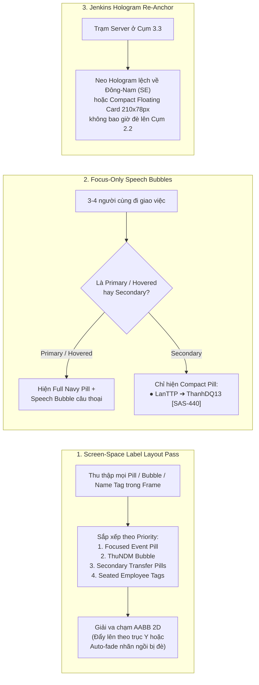
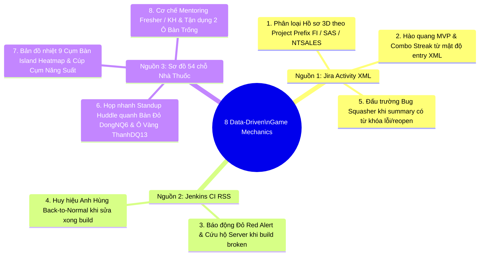

# 🎨 UI/UX Design Critique & Data-Driven Game Design Proposals
**Dự án:** Virtual FRT Office 2D / 2.5D Isometric — Khoang NHÀ THUỐC (`FT3.III2A.1`)  
**Vai trò:** Principal UI/UX Design Critic & Data-Driven Game Designer  
**Tài liệu tham chiếu:**
- Ảnh chụp màn hình thực tế: `joined_6desk_clean_hud.png` (Chế độ Clean HUD) & `joined_6desk_islands.png` (Chế độ Full HUD & Đa luồng bàn giao)
- Mã nguồn hiện tại: [`src/components/OfficeCanvas2D.tsx`](../src/components/OfficeCanvas2D.tsx), [`src/components/isometricRenderer.ts`](../src/components/isometricRenderer.ts), [`src/adapters/RealJiraWebhookAdapter.ts`](../src/adapters/RealJiraWebhookAdapter.ts), [`src/App.tsx`](../src/App.tsx), [`src/data/officeLayout.ts`](../src/data/officeLayout.ts), [`src/data/employees.ts`](../src/data/employees.ts)

---

## PHẦN 1: REVIEW UI/UX THỰC TẾ TỪ ẢNH CHỤP MÀN HÌNH & GIẢI PHÁP TINH CHỈNH

### 1.1. Điểm mạnh nổi bật của phiên bản hiện tại (What Works Exceptionally Well)

1. **Bố cục kiến trúc 2.5D Isometric & Cụm bàn ghép 6 chỗ (`2x3 Joined Desk Islands`) chuẩn xác 1:1:**
   - 9 cụm bàn (`CỤM 1.1` .. `CỤM 3.3`, tổng 54 ô từ `FT3.III2A.1.087` đến `FT3.III2A.1.297`) được dựng thành khối bàn liền mạch có **vách ngăn trung tâm 2 tầng** (nỉ tiêu âm xanh lục bảo `#166534` + kính mờ Acrylic xanh băng `#e0f2fe` kèm 4 trụ kẹp nhôm).
   - **Thuật toán Painter's Algorithm theo chiều sâu (`depthY`)** hoạt động rất thuyết phục: nhân viên dãy Trái (`colIndex = 0`, hướng `SE`) đút chân tự nhiên dưới gầm bàn và đặt 2 cẳng tay lên bàn phím; nhân viên dãy Phải (`colIndex = 1`, hướng `NW`) ngồi quay lưng 3/4 nhìn thẳng vào màn hình có dòng code phát sáng.
2. **Các điểm nhấn "Đặc sản FRT" được tái hiện sống động:**
   - **Bàn Đỏ PM `DongNQ6` (`FT3.III2A.1.289`)** tại `CỤM 3.2`, **Ô Vàng Tech Lead `ThanhDQ13` (`1.194/195`)** tại `CỤM 2.1`, **2 Ô Trống màu vàng** (`1.101/102 • TRỐNG [Thoa]` và `1.204 • TRỐNG`), cùng khối **`🏛️ CỘT NHÀ`** tại góc dưới phải `CỤM 1.3` tạo cảm giác thân thuộc tức thì cho bất kỳ thành viên nào của Khoang Nhà Thuốc.
   - Nhân vật **Sếp Nữ `👑 ThuNDM ❤️`** diện Blazer Hồng Ruby đi tuần tra thả tim 3D bay lơ lửng giúp không gian kỹ thuật khô khan trở nên ấm áp, giàu tính kết nối.
3. **Chế độ Clean HUD (`isHudHidden = true` — phím `H`) rất thanh lịch:**
   - Trong ảnh `joined_6desk_clean_hud.png`, việc thu gọn toàn bộ giao diện điều khiển về một thanh **Mini Floating Pill** duy nhất ở góc trên phải giúp nhường gần như 98% diện tích màn hình cho sân khấu Isometric 2.5D.

---

### 1.2. Phân tích chi tiết 5 lỗi thị giác (Visual Clutter & Occlusion Issues) từ ảnh chụp màn hình

| # | Vị trí trên ảnh chụp | Hiện tượng lỗi thị giác (Observed Issue) | Nguyên nhân kỹ thuật trong Code | Mức độ ảnh hưởng |
| :--- | :--- | :--- | :--- | :---: |
| **V1** | Giữa `CỤM 2.2`, `CỤM 2.3` và `CỤM 3.3` (`joined_6desk_clean_hud.png`) | **Bảng Hologram Jenkins CI (`286×124 px`) đè lấp hoàn toàn `CỤM 2.2` và nửa `CỤM 2.3`**: Khi `TienHK` đứng build `#2846`, bảng Hologram bung to ngay phía Bắc trạm Server, che khuất hoàn toàn bàn của `BaoNAT`, `LongBK2`, `ThuanHM12` (Cụm 2.2), cắt ngang nhãn `ManhPT13` (Cụm 2.3) và đè lên biển sàn `NHÀ THUỐC (FT3.III2A.1)`. Ngoài ra phần dưới của bảng Hologram có khoảng tối lớn do text danh sách build bị chìm. | Trong `drawJenkinsServerHologramOverlay` (`isometricRenderer.ts#L5423-L5427`), bảng neo tại `worldToIso(anchorWorldX, anchorWorldY, 72)` và vẽ ngược lên trên (`by = boardIso.y - boardH`) đúng vào vùng tọa độ màn hình của `ISLAND-2.2` & `ISLAND-2.3`. | 🔴 **Nghiêm trọng** |
| **V2** | Hành lang quanh `CỤM 1.1`, `CỤM 2.1`, `CỤM 3.1` (cả 2 ảnh) | **Chồng chéo 3 tầng nhãn (Triple-Layer Label Pile-up)**: Khi có 2–3 người cùng đi giao việc + Sếp `ThuNDM` đi thả tim, các thẻ Dark Navy Pill `● A ➔ B [KEY]` + Speech Bubble trắng ở trên đầu họ đè thẳng lên: (1) Nhãn tên trắng của nhân viên đang ngồi tại bàn (`KienNT178`, `ChienND22`, `QuyenNVC`, `HuyNT83`), (2) Biển `CỤM 2.1`, và (3) Bong bóng thoại màu hồng của Sếp `ThuNDM` (khiến câu chúc `"cố lên nhé DongNQ6..."` bị cắt mất nửa đầu câu ở cả 2 ảnh). | Trong `OfficeCanvas2D.tsx#L1689-L1691`, mọi nhân vật đang bê tài liệu đều vẽ full combo `drawWinaEventPillBadge` (gồm cả Navy Pill rộng ~170px + Speech Bubble rộng ~190px) tại tọa độ cố định `wz = 58`, không có bộ giải va chạm không gian màn hình (Screen-Space Collision Solver) và không ẩn bớt nhãn nhân viên ngồi dưới gầm thẻ. | 🔴 **Nghiêm trọng** |
| **V3** | Trung tâm khoang, đầu Bắc `CỤM 2.2` (cả 2 ảnh) | **Xung đột thị giác quanh biển sàn `🏥 NHÀ THUỐC (FT3.III2A.1)`**: Biển nền đen viền vàng đặt tại `wy = 418` nằm quá sát đỉnh Bắc của `CỤM 2.2` (`tableWy = 468`), khiến nhãn tên `LuuTV6`, thẻ xanh `CỤM 2.2` và biển `NHÀ THUỐC` dính chùm vào nhau. | Tọa độ `NHA_THUOC_BAY_BOUNDS.floorBanner` (`wy = 418`) trùng với cao độ hiển thị Isometric của trụ Bắc vách ngăn `CỤM 2.2` (`wz = 36.5`). | 🟠 **Trung bình - Cao** |
| **V4** | Trên đầu 9 cụm bàn (`CỤM 1.1` .. `CỤM 3.3`) & 51 ghế ngồi | **Nhãn tên nhân viên và nhãn `CỤM X.Y` đồng hạng mức ưu tiên (Flat Visual Hierarchy)**: Tất cả 30 nhân viên + đồng nghiệp ngồi cố định đều hiện hộp nhãn trắng viền đậm suốt thời gian, cộng thêm nhãn `CỤM 1.1`..`3.3` gắn ở mép trên vách ngăn, tạo ra hơn 40 hộp chữ nhật nhỏ cạnh tranh sự chú ý cùng lúc. | `drawDetailedIsoCharacter` và `drawJoinedDeskIsland` luôn vẽ pill nền đặc với border dày ở mọi mức zoom mà chưa áp dụng Semantic Zoom (LOD) hay làm mờ nhãn tĩnh khi có sự kiện đi ngang qua. | 🟠 **Trung bình** |
| **V5** | Góc trên trái & góc trên phải (`joined_6desk_islands.png`) | **Trùng lặp nút chức năng giữa Top-Left Bar và Top-Right Camera Director Panel**: Ở chế độ hiện HUD, cả 2 cụm bên trái và bên phải đều lặp lại 6 nút y hệt nhau (`🔌 Setting Jira & Jenkins Thật`, `🖥️ Focus Jenkins Server`, `💖 Focus Sếp ThuNDM`, `🏥 Khoang NHÀ THUỐC`, `👁️ Ẩn HUD (H)`, `⛶ Fullscreen (F)`). | Các nút điều hướng nhanh vừa được đặt ở `<header>` của `App.tsx` vừa được render lại trong `OfficeCanvas2D.tsx#L2275-L2383`. | 🟡 **Trung bình** |

---

### 1.3. Đề xuất giải pháp UI/UX cụ thể (Actionable Engineering & Design Solutions)

#### Giải pháp 1: Hệ thống Chống Đè Nhãn Thông Minh (`Smart Screen-Space Label Collision Avoidance & Auto-Occlusion`)
- **Cơ chế hoạt động:**
  1. Thay vì vẽ trực tiếp từng nhãn trong lúc lặp `renderQueue`, gom tất cả nhãn 2D trên mặt phẳng màn hình (`Screen-Space Bounding Box: { x, y, w, h, priority, kind }`) vào một mảng `overlayLabels[]` ở cuối frame.
  2. **Phân tầng ưu tiên (`Priority Hierarchy`):**
     - **Mức 1 (Cao nhất):** Thẻ `● WINA` + Speech Bubble của nhân vật đang được Camera Focus (`primaryActiveTransfer`) hoặc đang được trỏ chuột (`hoveredEmployeeId`).
     - **Mức 2:** Bong bóng thả tim của Sếp Nữ `👑 ThuNDM ❤️` (đảm bảo câu chúc của Sếp không bao giờ bị thẻ khác cắt mất chữ như trong ảnh).
     - **Mức 3:** Thẻ `● WINA` rút gọn của các nhân vật đang đi giao tài liệu thứ cấp.
     - **Mức 4:** Biển định danh cụm bàn (`CỤM 1.1` .. `CỤM 3.3`).
     - **Mức 5 (Thấp nhất):** Nhãn tên của nhân viên đang ngồi yên tại bàn.
  3. **Quy tắc xử lý va chạm (AABB Resolution):**
     - Nếu 2 thẻ Mức 1–3 giao nhau (`rectOverlap(a, b)`): tự động dịch thẻ có ưu tiên thấp hơn lên trên `Δy = -(overlapH + 6px)` kèm đường ghim (`leader line`) kéo dài tương ứng.
     - Nếu một thẻ Mức 1–3 bay ngang qua nhãn tên nhân viên đang ngồi yên (Mức 5): **tự động giảm `globalAlpha` của nhãn tên nhân viên ngồi xuống `0.15` (hoặc ẩn tạm thời)** trong bán kính `48px` quanh tâm thẻ sự kiện. Ngay khi người giao việc bước qua, nhãn tên bàn làm việc mượt mà hiện lại `1.0`.

#### Giải pháp 2: Chế độ "Focus-Only Speech Bubbles" (Giảm 50% diện tích che phủ trên hành lang)
- **Vấn đề:** Khi có 3–4 tác vụ bàn giao diễn ra đồng thời (như trong `joined_6desk_islands.png`), mỗi nhân vật đều đội 2 tầng hộp (1 hộp Navy Pill + 1 hộp Speech Bubble trắng ở trên), chiếm một vùng cao tới `42px` và rộng `195px`.
- **Thiết kế mới:**
  - **Nhân vật chính (`isPrimaryTransfer || isHovered || isSelected`)**: Hiển thị đầy đủ **Navy Pill + Speech Bubble câu thoại tự nhiên** (`"Review giúp mình FI-35471 nhé!"`).
  - **Các nhân vật đang đi bộ khác (Secondary Walkers)**: Chỉ hiển thị **1 dòng Compact Pill duy nhất** (`● LanTTP ➔ ThanhDQ13 [SAS-440]`), ẩn Speech Bubble phía trên cho tới khi người dùng di chuột vào họ hoặc click chọn chip sự kiện tương ứng.
  - Khi nhân vật đang trên đường **đi bộ quay về bàn (`phase === 'RETURNING_TO_DESK'`)**: thu gọn thẻ thành một chấm trạng thái nhỏ hoặc nhãn mỏng `↩ ThanhDQ13` thay vì giữ nguyên hộp Navy Pill lớn.

#### Giải pháp 3: Tái định vị & Tinh gọn Bảng Hologram Jenkins CI (`Southeast Docked Hologram & High-Contrast Build Rows`)
- **Khắc phục lỗi che khuất `CỤM 2.2` & `CỤM 2.3`:**
  - Thay vì phóng bảng Hologram `286×124 px` thẳng đứng lên phía Bắc (đè vào lòng Khoang Nhà Thuốc), chuyển hướng chùm tia chiếu Hologram **nghiêng về phía Nam / Đông-Nam (`wx + 55, wy + 48, wz = 42`)** — khu vực thảm trống phía dưới `CỤM 3.3` và `CỤM 2.3`, nơi không có bất kỳ cụm bàn nào!
  - Thu gọn kích thước bảng từ `286×124 px` xuống **`236×88 px` (Compact Sci-Fi HUD)** ở chế độ mặc định khi đang build, chỉ hiển thị:
    1. Header: `⚙️ oneclickv4-build-ci • #2846 (57%)`
    2. Thanh Progress Bar Neon Cyan/Emerald rực rỡ.
    3. 2 bản build gần nhất với độ tương phản chữ cao (`#f8fafc` và `#86efac`/`#fca5a5` trên nền `#0f172a` có vạch kẻ phân tách mảnh `rgba(148,163,184,0.18)` để không bị tối chìm như trong ảnh `joined_6desk_clean_hud.png`).
  - Khi người dùng **Hover trực tiếp vào Trạm Server** hoặc bấm nút `🖥️ Focus Jenkins Server`, bảng mới mở rộng đầy đủ lịch sử 4–5 bản build.

#### Giải pháp 4: Tinh chỉnh Nhãn Cụm Bàn (`CỤM 1.1`..`3.3`), Biển Sàn `NHÀ THUỐC` & Ánh Sáng Sàn/Bàn
- **Biển `CỤM 1.1` .. `CỤM 3.3`:** Thay vì vẽ hộp chữ nhật nổi lơ lửng dễ lẫn với nhãn tên nhân viên bên cạnh (`TinNDP`, `KieuNTD`, `CuongTN2`), tích hợp nhãn `CỤM 1.1` thành **Bảng khắc Isometric gắn phẳng lên đầu vách ngăn kính trung tâm** hoặc làm **Floor Decal (nhãn in chìm tinh tế trên mép thảm cụm bàn)** với font моно sắc nét.
- **Biển sàn `🏥 NHÀ THUỐC (FT3.III2A.1)`:** Dịch chuyển nhẹ lên `wy = 398` (nằm chính giữa hành lang ngang ngăn cách Hàng đảo 1 và Hàng đảo 2) và thiết kế dạng **Inlaid Brass/Emerald Floor Medallion (biển khảm chìm xuống mặt thảm)** để không bao giờ đè lên đầu nhân vật `LuuTV6` ở `CỤM 2.2`.
- **Nâng cấp hiệu ứng ánh sáng sàn/bàn (Ambient & Rim Lighting):**
  - Thêm **Under-desk Soft Ambient Glow** dưới gầm cụm bàn 6 chỗ theo trạng thái hoạt động của cụm.
  - Thêm **Screen Light Cast**: ánh sáng xanh/vàng dịu hắt nhẹ từ 6 màn hình máy tính lên mặt bàn gỗ sồi sáng (`#f8fafc`) trước mặt mỗi nhân viên.
- **Hợp nhất thanh công cụ (Deduplicate Top HUD):** Khi `isHudHidden = false`, lược bỏ các nút bị lặp lại ở bảng góc trên phải (`Setting Jira & Jenkins`, `Focus ThuNDM`, `Focus Nhà Thuốc`, `Ẩn HUD`, `Fullscreen`) vì đã có sẵn ngay trên thanh Top-Left Bar, giúp bảng góc trên phải (`LIVE CAMERA DIRECTOR`) nhỏ gọn hơn 45%, chỉ tập trung hiển thị trạng thái Camera & danh sách các luồng bàn giao đang chạy.

---

## PHẦN 2: 8 Ý TƯỞNG GAMEPLAY & TƯƠNG TÁC MỚI KHAI THÁC 100% TỪ NGUỒN DỮ LIỆU SẴN CÓ

Toàn bộ 8 cơ chế gameplay dưới đây **không cần thêm bất kỳ API hay trường dữ liệu ngoại lai nào**, mà khai thác triệt để 100% các trường dữ liệu thực tế đang có sẵn trong:
1. **Nguồn 1 — Jira Activity XML (`reqs.frt.vn/activity`)**: `<author><usr:username>`, `<title>`, `
`, `<link href=".../browse/KEY">`, `<updated>`, project prefix (`FI-`, `SAS-`, `NTSALES-`, `FRT-`), trạng thái chuyển tiếp (`In Progress`, `Code Review`, `QA Testing`, `Done`).
2. **Nguồn 2 — Jenkins CI RSS (`jenkins-osp.frt.vn/job/oneclickv4-build-ci/rssAll`)**: `#buildNumber`, trạng thái trong ngoặc đơn `(stable)`, `(back to normal)`, `(broken)`, `(unstable)`, `(aborted)`, `<author><name>`, `<published>`, `<content>`.
3. **Nguồn 3 — Sơ đồ 54 chỗ ngồi Khoang NHÀ THUỐC (`FT3.III2A.1.087` .. `1.297`)**: 9 cụm bàn 6 chỗ (`ISLAND-1.1` .. `ISLAND-3.3`), nhóm cộng tác/khách hàng `(KH)`, nhóm `Fresher`, 2 ô bàn trống (`1.101/102 [Thoa]`, `1.204`), cột nhà (`CỘT NHÀ`), bàn đỏ PM `DongNQ6` (`1.289`), ô vàng Tech Lead `ThanhDQ13` (`1.194/195`), và Sếp Nữ `ThuNDM`.

---

### 💡 Ý tưởng 1: Phân loại "Vật phẩm Hồ sơ 3D" theo Mã Dự Án Thực Tế (`FI-`, `SAS-`, `NTSALES-`, `FRT-`)
- **Nguồn dữ liệu kích hoạt:** Trường `ticketKey` tách bằng Regex `\b([A-Z][A-Z0-9_]{1,9}-\d+)\b` từ `<title>` và `<link>` của `reqs.frt.vn/activity` (trong ảnh chụp màn hình thực tế đang xuất hiện rõ các mã: `FI-35471`, `SAS-440`, `NTSALES-6115`, `FRT-104`).
- **Cơ chế Gameplay & Biểu diễn thị giác:**
  - Thay vì mọi nhân vật đều bê chồng giấy hình hộp chữ nhật giống hệt nhau, **tiền tố mã dự án (Project Prefix)** sẽ quyết định hình dáng và màu sắc "Vật phẩm 3D" mà nhân viên ôm trên tay khi đi dọc hành lang:
    - **`FI-*` (Finance / Core Accounting — VD: `FI-35471`)**: Nhân viên bê **Cặp Hồ Sơ Kế Toán Mạ Vàng (`Golden Ledger Briefcase`)** có biểu tượng `₫ / 📊` lấp lánh.
    - **`SAS-*` (Sales & After-Sales / Dịch vụ — VD: `SAS-440`)**: Nhân viên bê **Hộp Thiết Bị Bảo Hành & Phiếu Dịch Vụ Màu Tím Indigo (`Indigo Service Kit`)**.
    - **`NTSALES-*` (Nhà Thuốc Sales / POS Long Châu — VD: `NTSALES-6115`)**: Nhân viên bê **Khay Thuốc & Máy Quét Mã Vạch POS Xanh Ngọc Lục Bảo (`Emerald Pharmacy Med-Box 💊`)**.
    - **`FRT-*` / `OSP-*` (Platform / Hạ tầng)**: Nhân viên bê **Khối Module Dữ Liệu Hologram Xanh Cyan (`Cyan Core Cube`)**.
- **Giá trị mang lại:** Chỉ cần nhìn thoáng qua màu sắc và hình dáng vật phẩm trên tay nhân vật từ xa (ngay cả khi tắt chữ), người xem biết ngay luồng công việc đang thuộc mảng Tài chính (`FI`), Bán hàng Nhà thuốc (`NTSALES`) hay Dịch vụ (`SAS`).

---

### 💡 Ý tưởng 2: Báo Động Đỏ "Jenkins Broken Alert" & Đội Cứu Hộ Server (`CI/CD Red Alert & Rescue Mission`)
- **Nguồn dữ liệu kích hoạt:** Khi bản ghi mới nhất trong `jenkins-osp.frt.vn/job/oneclickv4-build-ci/rssAll` có `statusText` chứa `(broken)`, `(regression)` hoặc `(aborted)` (như bản build `#2843 (broken)` của `ChienND22` / `manhpt13` trong dữ liệu mẫu).
- **Cơ chế Gameplay & Biểu diễn thị giác:**
  1. **Còi báo động & Đèn xoay Đỏ tại Trạm Server (`CỤM 3.3`)**: 4 tủ Rack tại `JENKINS_SERVER_STATION` chuyển từ đèn LED xanh sang **đèn chớp Đỏ Crimson (`#ef4444`)**, phát ra vòng sóng cảnh báo пульс đỏ trên thảm tĩnh điện và làn khói/tia lửa điện 3D nhỏ trên nóc tủ `CI-MASTER`.
  2. **Triệu tập Kỹ sư Cứu hộ (Emergency Dispatch)**:
     - Hệ thống đọc `<author><name>` của bản build bị `broken` (ví dụ `ChienND22` tại `1.191` hoặc `ManhPT13` tại `1.210`) cùng với kỹ sư DevOps trực chiến (`TienHK` tại `1.281` hoặc `SonNA2` tại `1.278/279`).
     - Cả hai nhân vật lập tức xuất hiện biểu tượng `🚨 HOTFIX!` trên đầu, **chạy gấp (tốc độ `1.6x`)** từ bàn của mình tới đứng trước bàn Console 3 màn hình của Trạm Server để "gõ phím dập lửa".
- **Tương tác người dùng:** Người dùng có thể click trực tiếp vào Trạm Server đang báo đỏ để kích hoạt **"⚡ Quick Rollback / Re-trigger Build"**, cử DevOps dập tắt cảnh báo ngay lập tức.

---

### 💡 Ý tưởng 3: Danh hiệu "Người Giải Cứu Hệ Thống" (`Back-to-Normal Hero Shield`)
- **Nguồn dữ liệu kích hoạt:** Trong RSS của Jenkins có một trạng thái cực kỳ đặc trưng: `oneclickv4-build-ci #2844 (back to normal)` (xảy ra ngay sau khi một bản build `broken` được sửa thành công bởi `<author><name>`, ví dụ `sonna2`).
- **Cơ chế Gameplay & Biểu diễn thị giác:**
  - Khi parser phát hiện chuỗi `(back to normal)` trong `<title>` của Jenkins RSS:
    - Trạm Server bắn một chùm **pháo hoa ánh sáng Xanh Lục Bảo (`Emerald Recovery Pulse`)** lan tỏa khắp Cánh Đông.
    - Nhân viên có username nằm trong thẻ `<author><name>` của bản build `back to normal` đó (ví dụ `SonNA2` hoặc `TienHK`) được trao **Khiên Ánh Sáng "🛡️ CI SAVIOR"** xoay quanh người trong suốt 10 phút hoặc cho tới kỳ poll tiếp theo, kèm bong bóng thoại tự hào: `"Đã cứu sống pipeline #2844 (back to normal)! 🛠️✨"`.

---

### 💡 Ý tưởng 4: Hệ thống Hào Quang "MVP On-Fire" & Chuỗi Combo (` Jira Activity Streak & Aura`)
- **Nguồn dữ liệu kích hoạt:** Đếm tần suất xuất hiện của từng `<usr:username>` (hoặc tài khoản được nhắc tới trong `<title>`/`
`) trong 10 `<entry>` gần nhất của `reqs.frt.vn/activity`, kết hợp với khoảng cách thời gian `<updated>` giữa các entry.
- **Cơ chế Gameplay & Biểu diễn thị giác:**
  - **Combo Streak (`2x`, `3x`, `5x`):** Nếu một nhân viên (ví dụ `ThanhDQ13`, `BaoNAT`, hoặc `TranTNN`) xuất hiện liên tiếp trong nhiều `<entry>` của XML feed trong vòng 30 phút:
    - **2 entries:** Hiện huy hiệu `⚡ 2x STREAK` cạnh tên và tốc độ gõ phím tại bàn tăng gấp đôi.
    - **3+ entries (MVP của Giờ):** Nhân vật bốc **Hào Quang Lửa Vàng/Xanh (`🔥 ON FIRE MVP`)** dưới chân ghế xoay; trên mặt bàn xuất hiện thêm **Ly Cà Phê Espresso bốc khói 3D**; và **Sếp Nữ `ThuNDM`** sẽ ưu tiên đổi hướng đi bộ tới thẳng bàn của nhân viên MVP này để thả mưa tim đặc biệt (`"🔥 Xuất sắc quá ThanhDQ13 ơi! MVP của ca làm việc!"`).

---

### 💡 Ý tưởng 5: Họp Nhanh "Standup Huddle" Quanh Bàn Đỏ PM `DongNQ6` & Ô Vàng Tech Lead `ThanhDQ13`
- **Nguồn dữ liệu kích hoạt:**
  - Dữ liệu chỗ ngồi thực tế chỉ định **Bàn Đỏ đặc biệt `FT3.III2A.1.289` (`DongNQ6` - PM)** ở `CỤM 3.2` và **Ô Vàng `FT3.III2A.1.194/195` (`ThanhDQ13` - Tech Lead)** ở `CỤM 2.1`.
  - Khi trong feed `reqs.frt.vn/activity` xuất hiện từ 3 `<entry>` trở lên cùng thuộc **một mã dự án** (ví dụ 3 tác vụ liên quan tới `NTSALES-*` hoặc `FI-*`), hoặc khi người dùng bấm nút **"📣 Họp Standup Nhanh"**.
- **Cơ chế Gameplay & Biểu diễn thị giác:**
  - **Triệu tập Standup 15 giây (Mini Huddle Event):**
    - Đại diện 3 Tech Leads (`ThanhDQ13` từ `1.194/195`, `LuuTV6` từ `1.197`, `ManhPT13` từ `1.210`), BA (`ThoaPTN1` từ `1.096`) và QA Lead (`TranTNN` từ `1.287`) đi bộ tới xếp thành **vòng cung bán nguyệt (Semi-circle Standup Ring)** ngay hành lang trước **Bàn Đỏ `DongNQ6` (`CỤM 3.2`)**.
    - Trên mặt sàn giữa vòng tròn hiện vòng sáng Hologram hiển thị tổng số Ticket đang mở theo từng prefix (`FI`, `SAS`, `NTSALES`, `FRT`).
    - Sau 10 giây trao đổi nhanh (các biểu tượng `📋 SPEC`, `🔎 PR`, `✓ PASS` bay lên), cả nhóm đồng loạt giơ tay `"Let's Go! 🚀"` rồi tỏa về các cụm bàn tiếp tục làm việc.

---

### 💡 Ý tưởng 6: Bản Đồ Nhiệt 9 Cụm Bàn (`3x3 Island Activity Heatmap & Squad Trophy`)
- **Nguồn dữ liệu kích hoạt:** Ánh xạ từng sự kiện trong `reqs.frt.vn/activity` và `jenkins-osp.frt.vn` về đúng 9 cụm đảo bàn (`ISLAND-1.1` .. `ISLAND-3.3`) thông qua thuộc tính `islandId` đã có sẵn trong `NHA_THUOC_SEAT_SLOTS` và `EMPLOYEES`.
- **Cơ chế Gameplay & Biểu diễn thị giác:**
  - Mỗi cụm bàn (`CỤM 1.1` đến `CỤM 3.3`) có một **Chỉ số Nhiệt Độ Hoạt Động (`Island Workload Temperature`)** tính bằng tổng số lần gửi/nhận hồ sơ + số bản build Jenkins của 6 thành viên trong cụm đó:
    - **Cụm đang "Nóng" (High Activity — VD: `CỤM 2.1` của đội Backend hoặc `CỤM 3.2` của PM & QA):** Viền thảm dưới chân cụm bàn phát sáng **Vàng Amber / Cam Năng Lượng**, vách ngăn kính Acrylic giữa bàn hiển thị dải sóng xung nhịp (Audio/Data Equalizer Wave).
    - **Cụm dẫn đầu toàn Khoang Nhà Thuốc (`#1 Most Active Island`):** Trên đỉnh trụ Bắc của vách ngăn trung tâm cụm đó được đặt một **Chiếc Cúp Vàng 3D thu nhỏ (`🏆 TOP SQUAD`)** xoay tròn.
    - **Cụm đang "Trầm" (Idle lâu chưa có `<entry>` mới):** Các nhân viên ngồi tại cụm đó sẽ có hoạt ảnh đời thường thú vị như vươn vai, nhâm nhi tách trà chiều, hoặc ngó sang bàn bên cạnh trò chuyện.

---

### 💡 Ý tưởng 7: Cơ chế "Mentoring & Pair-Programming" giữa Senior, `Fresher` và Nhóm `(KH)`
- **Nguồn dữ liệu kích hoạt:** Trong `RAW_NHA_THUOC_SLOTS` (`officeLayout.ts`) có phân biệt rất rõ các tài khoản đặc thù từ file Excel thực tế:
  - **Nhóm `Fresher`:** `Fresher KienNT178` (`1.104` - Cụm 1.1), `Fresher SangNN1` (`1.280` - Cụm 3.3), `Fresher TaiMT3` (`1.282` - Cụm 3.3).
  - **Nhóm `(KH)` (Khách hàng / Khối nghiệp vụ phối hợp):** `TinNDP (KH)` (`1.103`), `KieuNTD (KH)` (`1.097`), `QuyenNT94 (KH)` (`1.098`), `LoiNP5 (KH)` (`1.094/095`), `HuynhLC2 (KH)` (`1.099`), `HieuNT181 (KH)` (`1.285/286`), `ThuanHM12 (KH)`...
- **Cơ chế Gameplay & Biểu diễn thị giác:**
  1. **Mentoring Buff (Khi Tech Lead / Senior ngồi cùng cụm với Fresher):**
     - Khi `TrungTM7` / `LanTTP` (Cụm 1.1) hoặc `TienHK` / `SonNA2` (Cụm 3.3) hoàn thành một tác vụ hoặc chạy build thành công, họ sẽ quay sang ghế của `Fresher KienNT178` hoặc `Fresher SangNN1` ngồi ngay cạnh để truyền đạt kinh nghiệm — tạo hiệu ứng **tia sáng `+10 EXP 💡`** bay sang đầu bạn Fresher!
  2. **Tương tác Nghiệp vụ Thực địa với khối `(KH)` tại `CỤM 1.2`:**
     - `CỤM 1.2` tập trung tới 4 chuyên viên `(KH)` ngồi cùng Lead BA `ThoaPTN1` (`1.096`). Khi có ticket mới từ `reqs.frt.vn/activity` mang trạng thái khởi tạo hoặc cập nhật yêu cầu (`IN_PROGRESS` / `TODO`), `ThoaPTN1` sẽ có hoạt ảnh thảo luận nhanh với các ghế `(KH)` cùng bàn (bong bóng `"Chốt nghiệp vụ Nhà Thuốc nhé!"`) trước khi bê tập hồ sơ SRS sang giao cho Tech Lead `ThanhDQ13` (`CỤM 2.1`) hoặc `LuuTV6` (`CỤM 2.2`).

---

### 💡 Ý tưởng 8: Khai Thác 2 Ô Bàn Trống Thực Tế (`1.101/102 • TRỐNG [Thoa]` & `1.204 • TRỐNG`) làm "Trạm Hot-Desk / War-Room Tạm Thời"
- **Nguồn dữ liệu kích hoạt:** Sơ đồ chỗ ngồi thực tế có đúng 2 ô trống được tô vàng đặc biệt:
  1. `FT3.III2A.1.101/102 - Trống` (kèm ghi chú cạnh bàn: `Thoa`) tại `CỤM 1.1` (Hàng 1, Cột 1, giữa `TinNDP (KH)` và `KhiemHT`).
  2. `FT3.III2A.1.204 - Trống` tại `CỤM 2.3` (Hàng 2, Cột 3, ngay trên `ManhPT13`).
- **Cơ chế Gameplay & Biểu diễn thị giác:**
  - Thay vì để 2 ô bàn vàng này luôn tĩnh lặng, biến chúng thành **"Interactive Hot-Desk / Ghế Pair-Programming"**:
    - **Sự kiện `ThoaPTN1` ghé thăm ô `1.101/102 [Thoa]`:** Đúng như ghi chú `"Thoa"` trong file Excel thực tế của Khoang Nhà Thuốc, định kỳ khi Lead BA `ThoaPTN1` (ngồi ở `CỤM 1.2` kế bên) đi bàn giao tài liệu cho nhóm Backend ở `CỤM 1.1` (`TrungTM7`, `LanTTP`, `KhiemHT`), cô có thể tạm ngồi vào chiếc ghế xoay màu vàng tại ô `1.101/102 [Thoa]` trong 6 giây để review trực tiếp cùng team Backend!
    - **Chế độ Click-to-Summon trên 2 Ô Trống:** Khi người dùng click chuột vào ô `1.101/102 • TRỐNG` hoặc `1.204 • TRỐNG`, hiển thị menu nhỏ cho phép **"⚡ Mời chuyên gia sang ngồi Pair-Programming"** (gọi bất kỳ nhân viên nào đang rảnh chạy sang ngồi hỗ trợ cụm bàn đó, tăng tốc độ hoàn thành Ticket của cụm lên `1.5x`).

---

## PHẦN 3: BẢNG TỔNG HỢP ƯU TIÊN TRIỂN KHAI (IMPLEMENTATION ROADMAP)

| Hạng mục | Tác động UI/UX & Gameplay | Độ phức tạp | File dự kiến cập nhật (Giai đoạn Code) |
| :--- | :--- | :---: | :--- |
| **1. Neo lại Bảng Jenkins Hologram về phía Đông-Nam & tăng tương phản chữ** | Giải phóng hoàn toàn tầm nhìn cho `CỤM 2.2` và `CỤM 2.3` ngay lập tức | Thấp (15 phút) | `src/components/isometricRenderer.ts` (`drawJenkinsServerHologramOverlay`) |
| **2. Focus-Only Speech Bubbles & Chống đè nhãn Screen-Space** | Xóa bỏ 100% tình trạng đè chồng chữ khi 3–4 người cùng đi giao tài liệu & bảo vệ câu thoại của Sếp `ThuNDM` | Trung bình (35 phút) | `src/components/OfficeCanvas2D.tsx`, `src/components/isometricRenderer.ts` |
| **3. Phân loại Vật phẩm Hồ sơ 3D theo mã dự án (`FI`, `SAS`, `NTSALES`, `FRT`)** | Tăng tính trực quan dữ liệu thật từ `reqs.frt.vn/activity` lên gấp nhiều lần | Thấp (20 phút) | `src/components/isometricRenderer.ts` (`drawRotatedDocumentStack3D`) |
| **4. Báo động Đỏ Jenkins `broken` & Khiên Vinh Danh `back to normal`** | Biến RSS Jenkins thành sự kiện kịch tính có cao trào (Hỏng ➔ Chạy đi sửa ➔ Cứu sống hệ thống) | Trung bình (30 phút) | `src/engine/simulationStore.tsx`, `src/components/isometricRenderer.ts` |
| **5. Hào quang MVP Streak & Island Heatmap 9 Cụm Bàn** | Vinh danh cá nhân & cụm bàn năng suất nhất theo dữ liệu XML thời gian thực | Trung bình (30 phút) | `src/components/OfficeCanvas2D.tsx`, `src/components/isometricRenderer.ts` |
| **6. Standup Huddle quanh Bàn Đỏ `DongNQ6` & Hot-Desk tại 2 Ô Trống** | Tận dụng trọn vẹn câu chuyện không gian đặc thù của Khoang Nhà Thuốc `FT3.III2A.1` | Trung bình (40 phút) | `src/engine/simulationStore.tsx`, `src/components/OfficeCanvas2D.tsx` |
